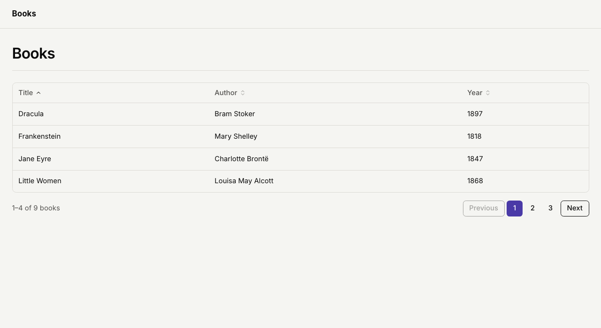

# Webframe

[](https://github.com/bplus/webframe/actions/workflows/ci.yml)

## What webframe is

Webframe is a Go module that allows you to write business-type CRUD applications for the web, without writing any HTML or CSS yourself.  It's intentionally either a) plain and boring or b) straightforward and simple, depending on your viewpoint. 

Use cases:

* Being done quickly and cleanly is more important than a bespoke design.
* You want built-in pagination, filtering, sorting, and a variety of pre-made widgets.
* You specifically don't want to write HTML or CSS to get a working application - it's not that it doesn't matter, it's that it doesn't always matter, for all kinds of applications. 

## A list page

Here is an index/list page for a book application, taken from step 2 of the tutorial. You describe the columns, give it the rows, and webframe does the rest, based on the defaults, with sorting, paging, etc. all built in. 

```go
func listBooks(w http.ResponseWriter, r *http.Request) {
	spec := liststate.Parse(r, bookQuery)
	page := liststate.Apply(books, spec, sorters, nil)

	var rows []datatable.Row
	for _, book := range page.Items {
		rows = append(rows, datatable.Row{Cells: []datatable.Cell{
			{Text: book.Title}, {Text: book.Author}, {Text: book.Year},
		}})
	}

	list := listpage.Props{
		Header: pageheader.Props{Title: "Books"},
		Columns: []datatable.Column{
			{Key: "title", Label: "Title", Sortable: true},
			{Key: "author", Label: "Author", Sortable: true},
			{Key: "year", Label: "Year", Sortable: true},
		},
		Rows:  rows,
		Spec:  page.Spec,
		Total: page.Total,
		Noun:  "books",
	}
	if err := listpage.Respond(w, r, "Books", list); err != nil {
		log.Print(err)
	}
}
```



`liststate.Parse` reads the sort and the page from the URL, so a reload or a
shared link shows the same view. `listpage.Respond` sends the whole page on a
normal visit and only the table when a column header or a page number is
clicked. The complete program, with `books`, `bookQuery` and `sorters`, is
[examples/02-list/main.go](examples/02-list/main.go).

## Getting started

You need Go 1.24 or newer. In your own module:

```bash
go get github.com/bplus/webframe@latest
```

To see the components running, clone this repository, start the demo, and
open http://localhost:3333:

```bash
make dev
```

## Where to go next

- [Tutorial](docs/tutorial/README.md): This is a short, seven-step tutorial, showing examples of a list, a form, a detail page, and edit/delete functionality. Each step is a complete program in [examples/](examples). [Step 7](docs/tutorial/07-templ.md) shows step 4 written with `.templ` files instead of plain Go; both are supported.
- [Components](docs/components.md): every package, what it is for, and where
  to see it in the demo.
- [How it works](docs/how-it-works.md): what happens when a browser asks for a
  page.
- API reference: [pkg.go.dev/github.com/bplus/webframe](https://pkg.go.dev/github.com/bplus/webframe)

## Background

I built webframe for one reason: I got sick of messing with look and feel when trying to just show an idea. That's it. For the work I do and the things I try to express, getting caught up in CSS and formatting just takes effort better spent elsewhere. 

## Goals 

- apps use components only and never write their own HTML or CSS;
- a linter enforces the above rule; 
- works on desktops and phones; 
- plan for failures by making failures obvious and easy to understand;
- the URL of an index/list/filterable page holds the state, to keep navigation and bookmarking easy. 

## Development

Requirements:

- Go
- `templ`
- Node/npm for the Tailwind CSS CLI and Playwright (pinned in `tools/package-lock.json`;
  `make css` runs `npm ci --prefix tools` on first use)

Common commands:

```bash
make build
make dev        # demo app on http://localhost:3333
make generate
make css
make check      # what CI runs: generated-file drift, go vet, go test, wflint
make ui-check   # Playwright measurement at phone and desktop width; needs `make dev` running
make containers-check   # Playwright: dialog and drawer scroll inside the screen; needs `make dev` running
```

`make ui-check` loads the demo in Playwright's own Chromium (one-time
`npx --prefix tools playwright install chromium`) at 390 and 1280 px, writes
screenshots to `tools/shots/` (git-ignored) and fails on horizontal overflow or
console errors; see `tools/README.md`.

The Tailwind CLI version is pinned in `tools/package.json` /
`tools/package-lock.json` so `output.css` is byte-stable.

## License

MIT. See [LICENSE](LICENSE). Third-party code included in this repository
(templUI, htmx, Alpine.js, 3d-force-graph and others) is listed with its
licenses in [THIRD_PARTY_NOTICES.md](THIRD_PARTY_NOTICES.md).
