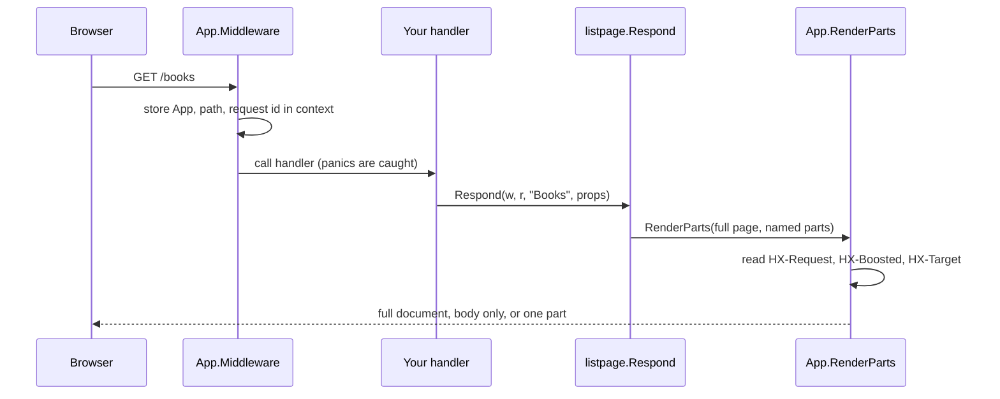
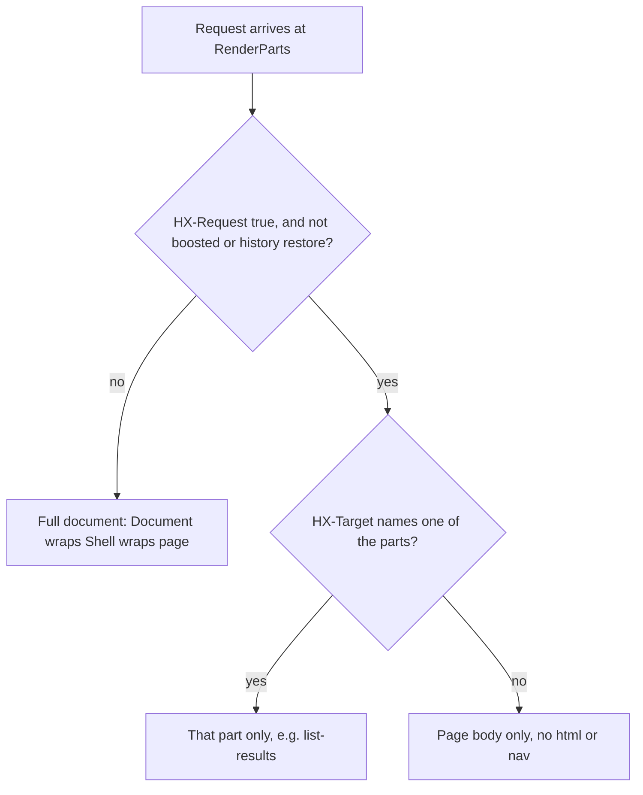
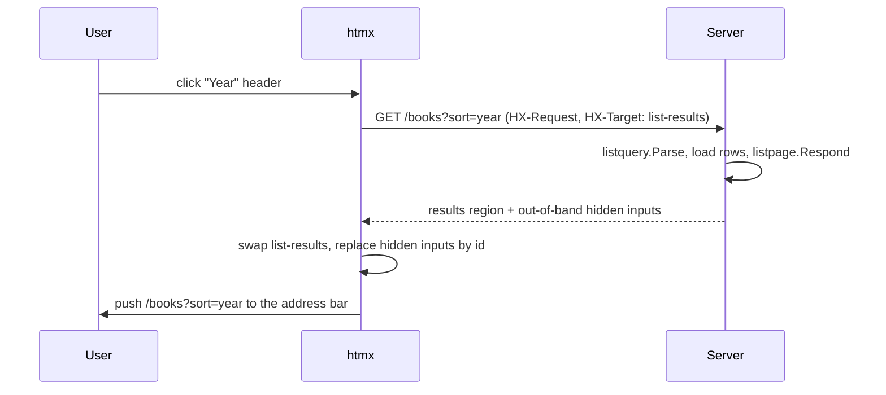
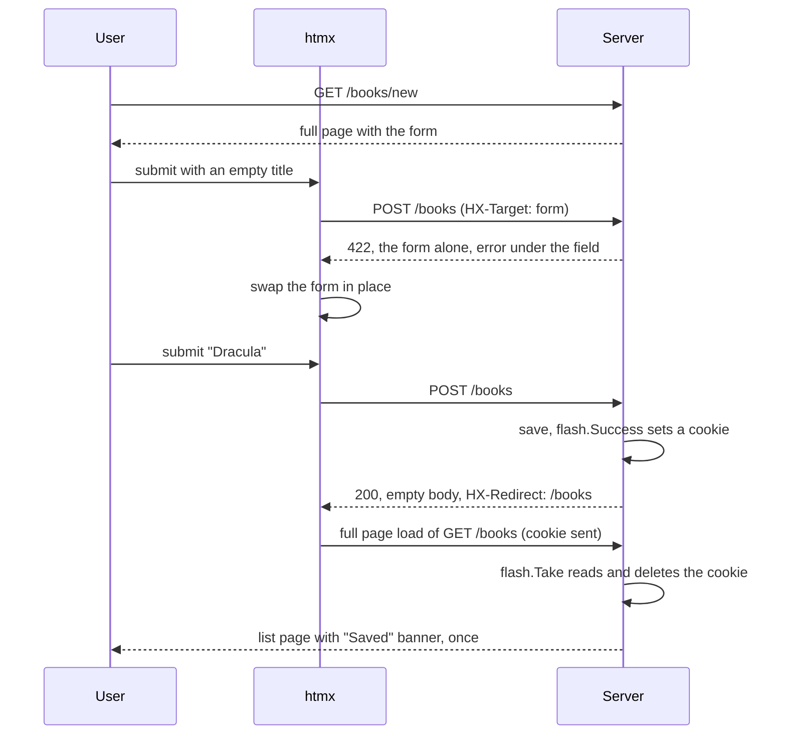
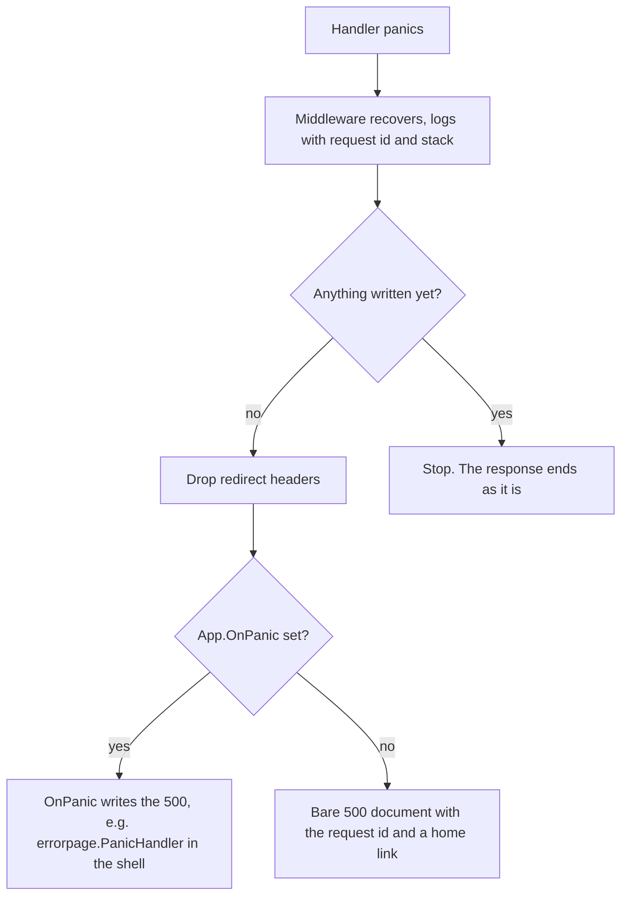

# How webframe works

The [tutorial](tutorial/README.md) shows what to write. This guide shows what happens after you
write it: which code runs when a browser asks for a page, and why it is built that way.

Each section explains the idea in plain English first, then points at the code. Links go to
exact lines; a link right after a name in backticks, as in `Respond` (file.go:12), shows that
name's code. Quotes are short, and each one is followed by what it says in plain words. You do
not need to read Go fluently to follow along.

A few words used throughout:

- **htmx** is the small JavaScript library on every webframe page. It lets a link or a form
  fetch HTML from the server and put it into one part of the page, instead of loading a whole
  new page. When htmx makes a request, it adds headers that start with `HX-`, such as
  `HX-Request: true`.
- **Swap** means htmx replacing part of the page with the HTML it fetched.
- **The target** is the element htmx will swap. htmx sends its id in the `HX-Target` header.
- **Out of band** (`hx-swap-oob`) is htmx's way of updating extra elements from one response:
  any top-level element in the response marked `hx-swap-oob` replaces the element on the page
  with the same id, wherever it is.
- **Context** is Go's way of attaching values to one request, so code deep in the call chain can
  read them without passing them by hand.

## 1. The life of a request

### The short version

Every request goes through four steps:

1. **`App.Middleware`** wraps your whole router. It attaches the `App` (your app name, nav and
   options) and a request id to the request, and catches panics.
2. **Your handler** runs. It loads data and fills in a declaration, such as a `listpage.Props`.
3. **The page type's `Respond`** (for example `listpage.Respond`) hands that declaration to the
   `App`.
4. **`App.RenderParts`** looks at the request headers and decides how much HTML to send back:
   the whole document, just the page body, or just one named region.



### Step 1: Middleware

`Middleware` is at [components/appshell/app.go:85](../components/appshell/app.go#L85-L119). It
stores three things in the request context:

```go
ctx := context.WithValue(r.Context(), appKey, a)
ctx = context.WithValue(ctx, pathKey, r.URL.Path)
ctx = context.WithValue(ctx, requestIDKey, id)
```

In plain words: attach the `App`, the request path and the request id to this request
([app.go:96-98](../components/appshell/app.go#L96-L98)). Later code reads them back with
`appshell.Must` ([app.go:270](../components/appshell/app.go#L270-L276), the `App`),
`PathFromContext` (the path, used to highlight the current nav item and to build list links,
[app.go:279](../components/appshell/app.go#L279-L282)) and `RequestID`
([app.go:166](../components/appshell/app.go#L166-L169)). That is why handlers never pass the
`App` around; forget the wrapper and `Must` returns an error naming `Middleware`.


The **request id** is a short string that appears in the log line for a panic and on the error
page the user sees, so a user's report can be matched to the log. The rules are at
[app.go:87-95](../components/appshell/app.go#L87-L95): reuse the id of an outer `Middleware` if
there is one, else take the `X-Request-Id` header if it looks safe (letters, digits, `.`, `_`,
`-`, at most 64 bytes, checked at [app.go:176](../components/appshell/app.go#L176-L189)), else
make 16 random hex digits ([app.go:193](../components/appshell/app.go#L193-L197)). The id used
is sent back in the response's `X-Request-Id` header
([app.go:100](../components/appshell/app.go#L100)), so the browser's network panel shows it too.

### Steps 2 and 3: your handler and Respond

Your handler builds a declaration and calls a `Respond`. Here is `listpage.Respond` in full
([components/listpage/listpage.go:502](../components/listpage/listpage.go#L502-L512)):

```go
app, err := appshell.Must(r.Context())
...
parts := map[string]templ.Component{p.ResultsID(): resultsPart(p)}
return app.RenderParts(w, r, title, Page(p), parts)
```

In plain words: find the `App`; check the declared actions (`action.ValidateAll`, which
rejects a `Submit` button that also sends its own request, or a `Form` on a plain link); offer
two ways to draw this page, the whole page body (`Page(p)`) and the results region alone, filed
under that region's id (`list-results` by default); let the `App` pick one.

`formpage.Respond`
([components/formpage/formpage.go:248](../components/formpage/formpage.go#L248-L261)) has the
same shape. Its one named part is the `<form>` itself, and it adds a status code, which [section
3](#3-a-form-round-trip) explains.

### Step 4: the three kinds of request

`RenderPartsStatus` ([app.go:523](../components/appshell/app.go#L523-L551)) is where every page
is written. It sorts requests into three kinds:

| Request | How it is recognized | What is sent |
|---|---|---|
| Normal browser visit (typed URL, plain link, reload) | no `HX-Request` header | the whole document: `<html>`, head, nav shell, page |
| htmx request aimed at a named region | `HX-Request: true` and `HX-Target` names a key in the parts map | only that region |
| any other plain htmx request | `HX-Request: true`, target not a named part | the page body, without `<html>` or nav |

The first question, "does this request want a piece or a whole page?", is `WantsFragment`
([app.go:309](../components/appshell/app.go#L309-L313)):

```go
return IsHX(r) &&
    r.Header.Get("HX-Boosted") != "true" &&
    r.Header.Get("HX-History-Restore-Request") != "true"
```

In plain words: a piece is wanted only when htmx sent the request, and it is neither a "boosted"
link nor a history restore. Those two exceptions are htmx requests too, but htmx puts their
answer into the whole `<body>`, so they need the full document. (A history restore happens when
you press Back and htmx no longer has the old page in its own cache, so it asks the server
again.)

The second question, "which piece?", is answered at
[app.go:533-535](../components/appshell/app.go#L533-L535):

```go
if target := strings.TrimPrefix(r.Header.Get("HX-Target"), "#"); target != "" {
    if part := parts[target]; part != nil {
        frag = part
```

In plain words: read the target id from the header; if the page offered a part under that id,
send that part; otherwise send the whole page body.



### Why the Vary header lists those request headers

One URL, `/books`, can now produce three different responses depending on request headers. A
cache (the browser's own, or a proxy) normally stores one response per URL. Without a hint, it
could store the bare results table from a sort click and later hand it back for a normal visit
to `/books`: the user would see an unstyled table with no page around it.

The `Vary` response header is that hint. It tells caches "this response also depends on these
request headers; store them separately". Every render sets it through `SetHeaders`
([app.go:394](../components/appshell/app.go#L394-L403)), listing `HX-Request, HX-Boosted,
HX-History-Restore-Request, HX-Target` ([app.go:318](../components/appshell/app.go#L318)):
exactly the four headers the two questions above read.

## 2. A list page round trip

### The idea: the URL is the list's state

Which column is sorted, which page you are on, what you searched for: all of it lives in the
query string, such as `/books?sort=year&dir=desc&page=2`. The server keeps nothing between
requests. That gives you reload, bookmarks, a shareable link and a working Back button for free.

`listquery.Parse` ([listquery/listquery.go:97](../listquery/listquery.go#L97-L99)) reads the
query string into a `Spec` ([listquery.go:51](../listquery/listquery.go#L51-L76)), which is a
plain struct: `Sort`, `Dir`, `Page`, `PageSize`, `Search`, `Filters`. Every value is checked
([`ParseValues`, listquery.go:129](../listquery/listquery.go#L129)): a sort key not in
`AllowedSorts` falls back to the default, a page below 1 becomes 1, and so on. So a hand-edited
URL cannot break the page.

Going the other way, `Spec.URL` ([listquery/url.go:30](../listquery/url.go#L30)) builds a link
from a `Spec` plus a change. A sort header link is `Spec.URL(base, listquery.WithSort("year"))`.
`WithSort` ([url.go:145](../listquery/url.go#L145-L159)) flips the direction if you are already
sorted by that column, else sorts ascending, and always goes back to page 1.

### Clicking a sort header



Each sortable header is a link with both a normal `href` and htmx attributes
([components/datatable/datatable.go:261](../components/datatable/datatable.go#L261-L269)):

```go
attrs := templ.Attributes{"href": url}
if p.HxTarget != "" {
    attrs["hx-get"] = url
    attrs["hx-target"] = p.HxTarget
    attrs["hx-push-url"] = "true"
```

In plain words: the link works without JavaScript (`href`); with htmx it fetches the same URL,
puts the answer into the results region, and writes the URL into the address bar. `listpage`
sets `HxTarget` to `#list-results` ([listpage.go:474](../components/listpage/listpage.go#L474)).
The pagination links do the same thing.

On the server, your handler runs exactly as it did for the first visit. The only difference is
the `HX-Target: list-results` header, so `RenderParts` picks the results part instead of the
whole page. Your handler code does not know or care which kind of request it is serving.

The results region is defined at
[components/listpage/listpage.templ:70](../components/listpage/listpage.templ#L70-L76): a `<div
id="list-results">` holding the table and the pagination, and nothing else. Keeping the page
title out of it means a swap never duplicates the header.

### Why the out-of-band copies

The filter bar sits above the results region, outside it. It holds hidden inputs for `sort`,
`dir` and `per` (page size), so that changing a filter keeps your current sort
([listpage.go:375](../components/listpage/listpage.go#L375-L383)). `page` is left out on
purpose, so a filter change lands on page 1.

Now the problem. You click the "Year" header. Only the results region is swapped, so the filter
bar's hidden `sort` input still says "title". You then pick a filter. The bar sends
`sort=title`, and your sort is silently undone.

The fix: every results-only response also carries fresh copies of those hidden inputs, marked
`hx-swap-oob="true"`. htmx finds each one's id on the page and replaces it. That is
`resultsPart` ([listpage.templ:84](../components/listpage/listpage.templ#L84-L95)):

```templ
@Results(p)
if p.hasFilterBar() {
    @filterbar.HiddenOOB(p.filterbarID(), p.hiddenInputs(), p.sortControls()...)
}
if counted := p.filterControls(); len(counted) > 0 {
    @filterbar.ControlsOOB(p.filterbarID(), counted...)
}
if p.Intro != "" {
    <p id={ p.introID() } class={ introClass } hx-swap-oob="true">{ p.Intro }</p>
```

In plain words: send the results; then send the filter bar's hidden inputs again, flagged to
replace the old ones; then send the intro line again too, so its counts ("14 items, 3 drafts")
stay correct after a delete. `HiddenOOB` is at
[components/filterbar/filterbar.templ:246](../components/filterbar/filterbar.templ#L246-L259).
`ControlsOOB` sends a filter control again the same way when one of its options has a `Count`
(never the search box, which may have the focus), so the count can change with every answer:
"Drafts 3" becomes "Drafts 1" when the search narrows the list. A list whose filters have no
counts sends no filter control.
On a list with sortable columns the `sort` value is carried by a visible "Sort" select (shown on
phones, where some headers are hidden), and the out-of-band copy replaces that select too, so
the headers and the select never disagree.

### Changes made from inside the list

A row's Delete button sends `DELETE /books/7`. That URL says nothing about which page and sort
the user is looking at. htmx also sends `HX-Current-URL`, the address bar's URL.
`listquery.ParseCurrent` reads the `Spec` from that
([listquery.go:106-122](../listquery/listquery.go#L106-L122)), and `listpage.RespondResults`
([listpage.go:523](../components/listpage/listpage.go#L523-L532)) sends just the results part,
plus an `HX-Replace-Url` header so the address bar shows the state that was actually served (for
example page 3 became page 2 because its last row is gone).

## 3. A form round trip



### GET: the empty form

`formpage.Respond` is called with the declaration and no errors. It is a normal visit, so the
whole page is sent. With `HxPost: true`, the form gets `hx-post`, `hx-target="#form"` and
`hx-swap="outerHTML"` ([formpage.go:148-152](../components/formpage/formpage.go#L148-L152)):
submit over htmx, and replace the whole `<form>` element with the answer. The plain `action` and
`method` stay on the form, so it still works without JavaScript.

### POST with bad input: 422

Your handler (see `createBook` in
[examples/04-validation/main.go:110](../examples/04-validation/main.go#L110-L128)) copies what
was typed into `Values`, puts messages into `Errors`, and calls `Respond` again. `Respond`
notices the errors ([formpage.go:255-259](../components/formpage/formpage.go#L255-L259)):

```go
status := 0
if len(p.Errors) > 0 {
    status = http.StatusUnprocessableEntity
}
return app.RenderPartsStatus(w, r, status, title, Page(p), map[string]templ.Component{p.id(): Body(p)})
```

In plain words: if anything is wrong, the status is 422; the named part is the form (`Body`),
filed under the form's id, which is what htmx names in `HX-Target`, so only the form comes back.

**Why 422 and not 200?** 422 "Unprocessable Entity" means "I understood the request, but the
data is not acceptable". A truthful status lets tests, logs, monitoring and browser tools see
that the submit failed, without reading the page.

**Why htmx must be told to swap it.** By default, htmx 2 ignores the body of any 4xx or 5xx
response: the form would just sit there, unchanged, with no error shown. So `Document` puts a
configuration into every page's `<head>`
([components/appshell/document.templ:31](../components/appshell/document.templ#L31) and
[:86](../components/appshell/document.templ#L86)):

```go
const htmxConfig = `{"responseHandling":[{"code":"204","swap":false},{"code":"[23]..","swap":true},{"code":"[45]..","swap":true,"error":true},{"code":"...","swap":true}]}`
```

In plain words: a 204 (No Content) swaps nothing; 2xx and 3xx swap; 4xx and 5xx swap too, but
still count as errors (htmx still fires its `htmx:responseError` event); anything else swaps.

**Why some error bodies are refused anyway.** "Swap every error" goes too far for one kind of
answer: a plain-text error. If a handler calls Go's `http.Error(w, "Internal Server Error",
500)`, swapping that would put the raw words "Internal Server Error" where the form was.
`static/js/htmx-errors.js` listens just before each swap
([htmx-errors.js:142-151](../static/js/htmx-errors.js#L142-L151)):

```js
if (!d || !d.isError) return;
if (swallows(d.target)) {
  d.shouldSwap = false;
} else if (!isHTML(d.xhr)) {
  d.shouldSwap = false;
  if (!splitpaneLink(d)) notify();
}
```

In plain words: leave successful responses alone; for an error, cancel the swap if the target is
marked `data-wf-swallow-errors`, or if the body is not HTML. In the second case the user also gets
a toast, "Could not load that. Nothing on the page changed. Try again in a moment.", so no failure
is silent. "HTML" means the `Content-Type`
says `text/html`, or the body starts like HTML: `<!doctype html`, a comment, or a known HTML
element such as `<form` or `<tr` ([htmx-errors.js:69-112](../static/js/htmx-errors.js#L69-L112)).
That rescues a fragment whose handler forgot the header, while an XML error (`<?xml`,
`<error>`) or text such as `<nil>` is still refused. The `data-wf-swallow-errors` mark
is on small polled elements, such as a nav badge count or a `logviewer`'s polled lines, where a
full error page would be garbage and the next poll repairs things anyway, and on a `splitpane`'s
detail region unless its `ShowErrors` is set. The practical rule: answer errors with `errorpage` or
`toast`, which send HTML, and never with `http.Error`.

**When there is no answer at all.** A request can also fail with no response: the network is
down, the server has stopped, or the request ran past `htmx.config.timeout`. htmx then fires
`htmx:sendError` or `htmx:timeout` instead of a swap, and `htmx-errors.js` shows the same
"Could not load that" toast ([htmx-errors.js:153-166](../static/js/htmx-errors.js#L153-L166)).
The same two exceptions hold: a target marked `data-wf-swallow-errors` stays silent, and a
`splitpane` list link is left to `splitpane.js`, which has its own toast (below). Each new
failure replaces the toast an earlier one left, so ten failed clicks show one toast, not ten.
Toasts sent by the server follow the same rule: each one carries a `data-wf-key` attribute (the
toast's `Key`, or a hash of its kind, title and body), and when it arrives it removes an older toast
with the same key. Ten refused clicks answered by `toast.Respond` show one toast; two different
toasts still show two.

**Why an error page sometimes moves, and sometimes becomes a toast.** htmx swaps an answer into
the request's target, and an element with `hx-get` or `hx-post` but no `hx-target` is its own
target. A 404 page pasted inside a "Refresh" or "Delete" button is garbage. `errorpage.Respond`
can tell this case apart: htmx sends no `HX-Target` header (or one equal to `HX-Trigger`, the id
of the element that sent the request). Then
([errorpage.go:61-79](../components/errorpage/errorpage.go#L61-L79)):

- for a GET, which only asked to load something, the answer is a toast and nothing else
  (`toast.Respond`, with the error status and `HX-Reswap: none`): the button and the page stay
  as they were. Its words are `appshell.LoadFailed`
  ([document.templ:116-120](../components/appshell/document.templ#L116-L120)), the same toast
  `htmx-errors.js` copies from a hidden `<template>` that `Document` renders, so an app changes
  them in one place, in Go. A polled element marked `data-wf-swallow-errors` still shows nothing.
- for an action (POST, PUT, PATCH, DELETE), the error page replaces the page content: the answer
  carries `HX-Retarget: #wf-main`, the id of the page's `<main>`. A `RenderBare` page, such as
  the sign-in page, has a plain `<main id="wf-main">` too
  ([app.go:418](../components/appshell/app.go#L418-L429)), so the error lands there as well.

A request aimed at a named region (a list's results, a split pane's detail, a lazy tab's panel)
gets the error page in that region, as before.

A refused swap must not leave the user wondering why nothing happened. A failed `logviewer` poll is
dropped without a word, which is fine: the next poll a few seconds later repairs it. A `splitpane`
list click is different: the user asked for something. So when its request fails, the detail region
and the address bar stay as they were and `static/js/splitpane.js` shows a toast
([splitpane.js:72-87](../static/js/splitpane.js#L72-L87)): "That item is no longer here. It may have
been deleted." for a 404 or 410 answer, "Could not load that item. Try again." for any other error
or for no answer at all. The pane renders both toasts, already worded, inside hidden `<template>`
elements, so an app changes the words with the pane's `Gone` and `Failed` fields and writes no
JavaScript. `htmx-errors.js` shows nothing for these links, so a failed click shows one toast,
the pane's.

### POST with good input: redirect, then the flash

On success, `createBook` calls `flash.Success(w, r, "Saved", ...)` and then
`appshell.Redirect(w, r, "/books")`.

**The redirect** ([app.go:296](../components/appshell/app.go#L296-L303)):

```go
if IsHX(r) {
    w.Header().Set("HX-Redirect", url)
    w.WriteHeader(http.StatusOK)
    return
}
http.Redirect(w, r, url, http.StatusSeeOther)
```

In plain words: for an htmx submit, answer with an empty 200 and an `HX-Redirect` header; for a
plain form submit, answer with 303 See Other.

Why two answers? A 303 tells a browser "go GET this other page now", and because the next
request is a GET, pressing reload on the new page does not submit the form again. But htmx makes
its requests in the background, and the browser follows a 3xx in the background too, silently.
htmx would receive the whole list page as the "answer" to the POST and swap it into the form,
putting a page inside a page. `HX-Redirect` instead tells htmx "do a real page load of this
URL".

**The flash** is a one-time message that must survive that redirect. It travels in a cookie,
because the redirect is a brand-new request and the server keeps no memory between requests.

- `flash.Set` ([components/flash/flash.go:53](../components/flash/flash.go#L53-L63)) writes the
  message into the `wf_flash` cookie: JSON, base64-encoded, under 2 KB, expiring after 5
  minutes, unreadable from JavaScript (`HttpOnly`).
- On the next render, `RenderPartsStatus` calls `App.Flash` *before writing anything*
  ([app.go:541-544](../components/appshell/app.go#L541-L544)), because a cookie is a header and
  headers cannot change once the body starts. Your app set `App.Flash = flash.Take`.
- `flash.Take` ([flash.go:90](../components/flash/flash.go#L90-L109)) reads the cookie,
  immediately tells the browser to delete it, and returns a banner.
- The shell draws the banner in the `#wf-flash` slot at the top of `<main>`
  ([components/appshell/shell.templ:129-133](../components/appshell/shell.templ#L129-L133)).

Reading and deleting in the same response is what makes it "shown once": reload the list and the
banner is gone.

If the next render is a fragment instead of a full page (a flash set by an htmx action that does
not redirect), `RenderPartsStatus` still takes the flash and appends it as an out-of-band `<div
id="wf-flash">`, so it appears on the page the user is looking at
([app.go:449-464](../components/appshell/app.go#L449-L464)).

## 4. When things go wrong

### A panic in a handler

A panic is Go's version of an uncaught exception. Without help, `net/http` logs it and drops the
connection: the user sees a browser error page. `Middleware` catches it instead
([app.go:102-116](../components/appshell/app.go#L102-L116)):

```go
log.Printf("appshell: panic serving %s %s (request %s): %v\n%s", r.Method, r.URL.Path, id, v, debug.Stack())
if rw.wrote {
    return
}
stripRedirectHeaders(rw.Header())
a.answerPanic(rw, r, id, v)
```

In plain words: always log the panic with the request id and the stack trace. Then, if nothing
has been sent to the browser yet, clear any redirect headers the handler had set, and answer
with a 500 page. If something has already been sent, stop: the status line and part of the page
are gone, and nothing can be taken back.

"Has anything been sent?" is tracked by `recordingWriter`
([app.go:211-224](../components/appshell/app.go#L211-L224)), a thin wrapper around the response
that flips a `wrote` flag on the first status or body write.



Notes:

- The default answer is a bare page with no nav, showing the request id and a plain
  "Go home" link to `App.HomeHref` ([app.go:201](../components/appshell/app.go#L201-L207)). Set `App.OnPanic =
  errorpage.PanicHandler` for the styled 500 inside the shell
  ([components/errorpage/errorpage.go:137](../components/errorpage/errorpage.go#L137-L141)). If
  your `OnPanic` itself panics, the default answers instead
  ([app.go:140-161](../components/appshell/app.go#L140-L161)).
- Most panics happen in your handler before rendering starts, so the 500 page is the usual
  outcome. A panic during rendering may come after output has gone out (a non-200 page always,
  since its status is written first).

### 404 and 405 from the router

Go's standard router, `http.ServeMux`, answers two things itself, before any of your code runs:
"no such route" (404) and "this route exists but not for that method", such as a POST to a
GET-only route (405). Both come back as one line of plain text, and there is no hook to change
them.

`errorpage.Handler` wraps the router
([errorpage.go:152](../components/errorpage/errorpage.go#L152-L177)):

```go
h, pattern := mux.Handler(r)
if pattern != "" {
    mux.ServeHTTP(w, r)
    return
}
```

In plain words: ask the router which handler it would use. If a real route matched, run it
normally. If not, the router has picked its own fallback. Run that fallback into a dummy
response that keeps only the status and headers (`verdict`,
[errorpage.go:181-204](../components/errorpage/errorpage.go#L181-L204)), then: 405 becomes the
styled "Not allowed here" page (copying the router's `Allow` header, which lists the methods
that would work); 404 becomes the styled "not found" page; anything else, such as the redirect
the router uses to tidy up a path, goes through untouched.

Wire it inside `Middleware`, so the error pages can find the `App` and render in the shell:

```go
http.ListenAndServe(addr, app.Middleware(errorpage.Handler(mux)))
```

Do not register a `/` catch-all route: then every path matches something, and the router never
reports a 404 or a 405.

## 5. Where the HTML comes from

### templ files and generated Go

Components are written in **templ**, a template language that looks like Go with HTML inside.
Each component lives in `components/<name>/<name>.templ`. The `templ generate` command (`make
generate`) turns each `.templ` file into a `_templ.go` file of ordinary Go that writes the HTML.
The generated files are committed, but they are machine output: **never read them**, read the
`.templ` file next to them. The Go code they hold looks noisy and says nothing the `.templ` does
not.

Some components also have a plain `.go` file beside the `.templ` for helper functions
(`listpage.go` holds `Respond` and all the decisions; `listpage.templ` holds only the markup).

### Props structs, and why components take `...Props`

Each component takes one settings struct called `Props`. Most share three fields: `ID`, `Class`
(extra Tailwind classes, for library code only) and `Attributes` (extra HTML attributes). A
field left empty means "use the default".

Many components are declared as `Button(props ...Props)`. The `...` makes the argument optional:
Go has no optional arguments, so this is the usual trick. `button.Button()` uses all defaults;
`button.Button(button.Props{Variant: ...})` sets some. Only the first one counts
([components/button/button.templ:70-74](../components/button/button.templ#L70-L74)):

```templ
templ Button(props ...Props) {
    {{ var p Props }}
    if len(props) > 0 {
        {{ p = props[0] }}
    }
```

In plain words: start from an all-defaults `Props`; if the caller passed one, use that instead.

### utils.TwMerge

Inside components, classes are combined with `utils.TwMerge`
([utils/templui.go:18](../utils/templui.go#L18-L35)), never by gluing strings. Tailwind classes
can conflict: `bg-red-500` and `bg-green-500` both set the background. With plain concatenation
both end up in the HTML and whichever comes later in the CSS file wins, which is not the one you
asked for. `TwMerge` understands Tailwind and drops the earlier of two conflicting classes, so a
component puts its defaults first and the caller's `Class` last, and the caller wins.

### Theme tokens in input.css

`static/css/input.css` is the source stylesheet; `make css` compiles it with Tailwind into
`static/css/output.css` (generated, do not edit). Three things in it matter:

- **Tokens.** Colors are named by role, not hue: `--color-background`, `--color-primary`,
  `--color-destructive` and so on, defined inside `@theme`
  ([input.css:19](../static/css/input.css#L19), light values from
  [input.css:62](../static/css/input.css#L62)). Components write `bg-primary`, never
  `bg-purple-700`. The dark theme only redefines the tokens under `:root[data-theme="dark"]`
  ([input.css:105](../static/css/input.css#L105)), so switching themes is one attribute on
  `<html>`, set by a small script in the page's `<head>`
  ([document.templ:74-82](../components/appshell/document.templ#L74-L82)).
- **`dark:` follows the toggle.** Tailwind's `dark:` prefix normally follows the operating
  system setting. [input.css:17](../static/css/input.css#L17) points it at the `data-theme`
  attribute instead, so it agrees with the tokens.
- **Which files are scanned.** Tailwind only puts into `output.css` the classes it finds in the
  files it scans. `source(none)` on [line 1](../static/css/input.css#L1) turns off automatic
  scanning, and [lines 3-10](../static/css/input.css#L3-L10) list exactly what to scan:
  component `.templ` and `.go` files (not tests) and the demo's `.templ` files. Your app is not
  scanned: app code is not allowed to write classes anyway (see [section 6](#6-the-linter)).

### When JavaScript is turned off

Pages, links, sort headers, page links and ordinary form posts are plain HTML, so they work
without JavaScript. The parts built on htmx or Alpine do not: buttons that act in place (such
as Delete, which sends a DELETE request), the filter bar and its search box, tabs, dropdown
menus, the command palette, the theme toggle, `selectbox` and `tagsinput` pickers in forms,
toasts, confirm dialogs and anything that polls. So `Document` opens every page's `<body>` with
a warning banner inside `<noscript>`
([document.templ:94](../components/appshell/document.templ#L94), wording at
[:136-139](../components/appshell/document.templ#L136-L139), markup at
[:143-149](../components/appshell/document.templ#L143-L149)). A browser running JavaScript
ignores the contents of `<noscript>`, so the notice costs nothing there. The wording names
kinds of control rather than one app's buttons, so it stays true for any webframe app.

### Assets: the static folder inside the binary

The CSS, JavaScript and fonts in `static/` are compiled into your program, so deploying is
copying one file. The line that does it is in [embed.go:11-12](../embed.go#L11-L12):

```go
//go:embed static
var Static embed.FS
```

In plain words: at build time, take the `static` folder and store it inside the program as a
read-only file system named `Static`. (It sits at the module root because Go's embed cannot
reach up into a parent folder.)

`assets.Mount(mux)` ([assets/assets.go:29](../assets/assets.go#L29-L31)) serves that file system
at `GET /static/`. Mount it at exactly that path: `Document` refers to `/static/...` URLs
directly. `assets.URL` adds `?v=<number>` to a file's URL; the number is the time the program
started ([utils/templui.go:134](../utils/templui.go#L134)), so every restart makes browsers fetch
fresh files instead of using a stale cached copy.

## 6. The linter

webframe's rule for app code: **app code chooses and orders components; it never writes layout
or styling.** No `<div>`, no `class`, no `style`. That way every app looks consistent, and a
design fix in the library reaches every app.

`wflint` enforces it. `make check-ui` runs it on the demo and the tutorial examples
([Makefile:41-42](../Makefile#L41-L42)). It reads `.templ`, `.go` and `.css` files and reports:

- **Elements.** Only text-level elements are allowed: `p, a, span, strong, em, b, i, code, kbd,
  br, ul, ol, li, time, small, sup, sub`
  ([internal/wflint/rules.go:15](../internal/wflint/rules.go#L15)). Anything else is reported
  with a hint naming the component to use instead, for example `<div>` → `layout.Stack or
  layout.Inline`, `<table>` → `datatable`
  ([rules.go:33-63](../internal/wflint/rules.go#L33-L63)). `<script>` is allowed (behavior is
  not design), but not with `class` or `style`.
- **Attributes.** On those elements, only `href, src, alt, title, id, name, datetime, target,
  rel, download`, plus anything starting `aria-`, `data-`, `hx-` or `x-`
  ([rules.go:24-26](../internal/wflint/rules.go#L24-L26)). Never `class` or `style`, and never
  Alpine's `:class` or `:style` ([rules.go:30](../internal/wflint/rules.go#L30)). Spreading an
  attribute map onto an element is also refused.
- **Go code.** No `templ.Raw`, `templ.FromGoHTML` or `templ.ComponentFunc` (all ways to write
  HTML by hand, [internal/wflint/gocode.go:12](../internal/wflint/gocode.go#L12)); no `Class:`
  in a `Props` literal; no `"class"` or `"style"` key in an attribute map; no Go string that
  holds HTML markup. Content HTML you already trust goes through the `prose` component, which is
  exempt.
- **CSS files.** Any `.css` file in app code is a violation by itself
  ([internal/wflint/lint.go:118](../internal/wflint/lint.go#L118-L122)).

**The one escape hatch** is a fence: wrap markup in `custompage.CustomPage` or
`customblock.CustomBlock` with a written `Reason`. Inside the fence the element and attribute
rules are off ([internal/wflint/walk.go:56-60](../internal/wflint/walk.go#L56-L60)). A fence
with no reason, or an empty one, is itself a violation
([walk.go:99](../internal/wflint/walk.go#L99-L107)), and every run prints every fence with its
reason, so they stay visible. A missing component is not a reason: the project rule is to stop
and ask for the component instead.

## 7. Where to read next

In this order. Each builds on the one before.

1. [examples/04-validation/main.go](../examples/04-validation/main.go): a whole app in 155
   lines. Everything below is what these calls do.
2. [components/appshell/app.go](../components/appshell/app.go): `Middleware`,
   `Render`/`RenderParts`, `Redirect`, `WantsFragment`. The heart of section 1.
3. [components/appshell/document.templ](../components/appshell/document.templ): the `<html>`
   skeleton every page shares, and the htmx config.
4. [listquery/listquery.go](../listquery/listquery.go) and
   [listquery/url.go](../listquery/url.go): the URL as list state, read and written.
5. [components/listpage/listpage.go](../components/listpage/listpage.go) and
   [listpage.templ](../components/listpage/listpage.templ): one page type end to end. Read the
   package comment at the top first.
6. [components/formpage/formpage.go](../components/formpage/formpage.go) and
   [formpage.templ](../components/formpage/formpage.templ): the second page type, and the 422
   rule.
7. [components/flash/flash.go](../components/flash/flash.go): the one-time message cookie.
8. [components/errorpage/errorpage.go](../components/errorpage/errorpage.go): error pages and
   the router wrapper.
9. [static/js/htmx-errors.js](../static/js/htmx-errors.js): 167 lines, mostly comments; the
   browser half of section 3.
10. [internal/wflint/rules.go](../internal/wflint/rules.go): what app code may write.
11. [components/appshell/shell.templ](../components/appshell/shell.templ): the nav chrome. Skim
    it; it is long because of phone and desktop layouts.

**Safe to skip:**

- Every `*_templ.go` file. Generated by `templ generate`; read the `.templ` beside it.
- `static/css/output.css`. Generated by `make css`.
- `static/js/*.min.js`, with one exception. Most are vendored copies of htmx, Alpine and the
  templUI component scripts; `static/js/PROVENANCE.md` says where each came from. The exception
  is `filterbar.min.js`: despite the name it is webframe's own hand-written script, and it is
  the browser half of the list page's filter bar (it submits the bar and rewrites the address
  bar). Read it if a filter misbehaves. The other first-party scripts are `confirm.js`,
  `htmx-errors.js`, `splitpane.js`, `autocomplete.js` and `theme-toggle.js`.
- The templUI-derived primitives: `aspectratio`, `avatar`, `badge`, `button`, `card`,
  `checkbox`, `dialog`, `dropdown`, `form`, `input`, `label`, `popover`, `radio`, `selectbox`,
  `separator`, `tabs`, `textarea` under `components/`. They are small styled building blocks
  adapted from the templUI library; the page types are built on them, but nothing about the
  request flow lives there.
- `components/icon/icon_data.go` and `icon_defs.go`: tables of SVG icon data.
- Tests, unless you want an example of one behavior (`components/appshell/recover_test.go` shows
  every panic case).
