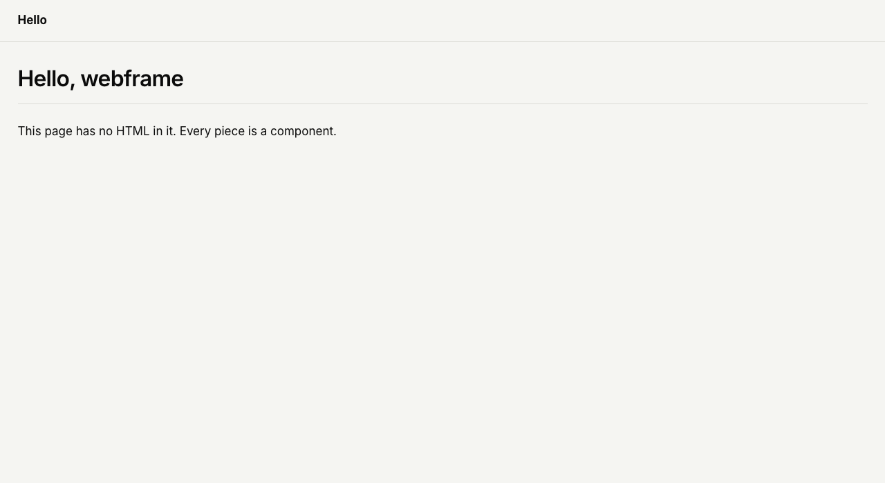

# Step 1: Hello, page

The smallest webframe app: one page inside the webframe shell. About 25 lines
of Go, no HTML, no CSS, no `.templ` files.



## Prerequisites

- Go 1.24 or newer
- A new module that depends on webframe:

```sh
mkdir hello && cd hello
go mod init example.com/hello
go get github.com/bplus/webframe@latest
```

## The code

Save this as `main.go`:

<!-- file: examples/01-hello/main.go -->
```go
// Command hello is tutorial step 1: one page in the webframe shell.
package main

import (
	"log"
	"net/http"

	"github.com/bplus/webframe/assets"
	"github.com/bplus/webframe/components/appshell"
	"github.com/bplus/webframe/components/pageheader"
	"github.com/bplus/webframe/components/prose"
	"github.com/bplus/webframe/compose"
)

var app = &appshell.App{Name: "Hello"}

func home(w http.ResponseWriter, r *http.Request) {
	page := compose.Join(
		pageheader.PageHeader(pageheader.Props{Title: "Hello, webframe"}),
		prose.Prose(prose.Props{Text: "This page has no HTML in it. Every piece is a component."}),
	)
	if err := app.Render(w, r, "Home", page); err != nil {
		log.Print(err)
	}
}

func routes() http.Handler {
	mux := http.NewServeMux()
	assets.Mount(mux)
	mux.HandleFunc("GET /{$}", home)
	return app.Middleware(mux)
}

func main() {
	log.Print("listening on http://localhost:8080")
	log.Fatal(http.ListenAndServe(":8080", routes()))
}
```

Run it with `go run .` and open http://localhost:8080.

## What each piece does

**`app`** is the shell: the top bar, the page frame, the stylesheet and the
scripts. Every page renders inside it. `Name` shows in the top bar and the
browser tab.

**`home`** is an ordinary Go HTTP handler. It builds the page out of two
components, a page header and a paragraph of text, and hands them to
`app.Render`. `compose.Join` puts components one after another.

**`app.Render`** writes the complete HTML document: the shell, the page title
(`Home — Hello`), and your page inside it.

**`routes`** wires everything to Go's standard router:

- `assets.Mount(mux)` serves webframe's CSS and JavaScript under `/static/`.
  They are built into the webframe module, so there is nothing to copy.
- `GET /{$}` matches the home page only. Without `{$}`, the pattern `/`
  would also match every unknown path.
- `app.Middleware(mux)` wraps every request so pages know which app they
  belong to. Every page type in the later steps needs it.

## Try it

- Make the window narrow. The page works at phone width without any extra code.
- Change the `Text`. A blank line in the string starts a new paragraph.

Next: [Step 2: A list](02-list.md)
