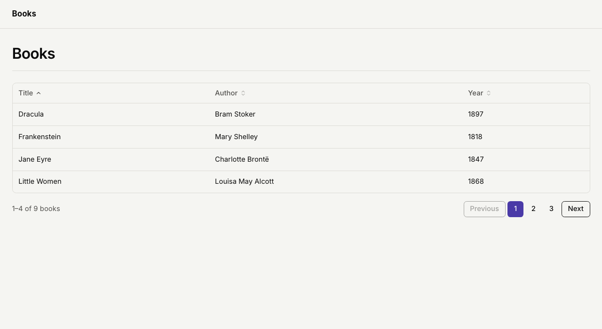

# Step 2: A list

A table of books that sorts by any column and splits into pages. The sort
and the page live in the URL, so a reload or a shared link shows the same
view. Still no HTML, no CSS, no `.templ` files.



## The code

Keep the same `books` directory and replace `main.go` from step 1 with this:

<!-- file: examples/02-list/main.go -->
```go
// Command books is tutorial step 2: a sortable, paged list of books.
package main

import (
	"log"
	"net/http"

	"github.com/bplus/webframe/assets"
	"github.com/bplus/webframe/components/appshell"
	"github.com/bplus/webframe/components/datatable"
	"github.com/bplus/webframe/components/listpage"
	"github.com/bplus/webframe/components/pageheader"
	"github.com/bplus/webframe/listquery"
)

var app = &appshell.App{Name: "Books"}

type Book struct {
	Title  string
	Author string
	Year   string
}

// books is the whole database: a slice in memory.
var books = []Book{
	{Title: "Pride and Prejudice", Author: "Jane Austen", Year: "1813"},
	{Title: "Frankenstein", Author: "Mary Shelley", Year: "1818"},
	{Title: "Jane Eyre", Author: "Charlotte Brontë", Year: "1847"},
	{Title: "Moby-Dick", Author: "Herman Melville", Year: "1851"},
	{Title: "Little Women", Author: "Louisa May Alcott", Year: "1868"},
	{Title: "Middlemarch", Author: "George Eliot", Year: "1871"},
	{Title: "Treasure Island", Author: "Robert Louis Stevenson", Year: "1883"},
	{Title: "The Time Machine", Author: "H. G. Wells", Year: "1895"},
	{Title: "Dracula", Author: "Bram Stoker", Year: "1897"},
}

// bookQuery is what the list reads from the URL: ?sort=year&dir=desc&page=2.
var bookQuery = listquery.Options{
	DefaultSort:     "title",
	DefaultPageSize: 4,
	AllowedSorts:    []string{"title", "author", "year"},
}

// sorters says how to order two books for each sortable column.
var sorters = map[string]func(a, b Book) bool{
	"title":  func(a, b Book) bool { return a.Title < b.Title },
	"author": func(a, b Book) bool { return a.Author < b.Author },
	"year":   func(a, b Book) bool { return a.Year < b.Year },
}

func listBooks(w http.ResponseWriter, r *http.Request) {
	spec := listquery.Parse(r, bookQuery)
	page := listquery.Apply(books, spec, sorters, nil)

	var rows []datatable.Row
	for _, book := range page.Items {
		rows = append(rows, datatable.Row{Cells: []datatable.Cell{
			{Text: book.Title}, {Text: book.Author}, {Text: book.Year},
		}})
	}

	list := listpage.Props{
		Header: pageheader.Props{Title: "Books"},
		Columns: []datatable.Column{
			{Key: "title", Label: "Title", Sortable: true},
			{Key: "author", Label: "Author", Sortable: true},
			{Key: "year", Label: "Year", Sortable: true},
		},
		Rows:  rows,
		Spec:  page.Spec,
		Total: page.Total,
		Noun:  "books",
	}
	if err := listpage.Respond(w, r, "Books", list); err != nil {
		log.Print(err)
	}
}

func routes() http.Handler {
	mux := http.NewServeMux()
	assets.Mount(mux)
	mux.Handle("GET /{$}", http.RedirectHandler("/books", http.StatusSeeOther))
	mux.HandleFunc("GET /books", listBooks)
	return app.Middleware(mux)
}

func main() {
	log.Print("listening on http://localhost:8080")
	log.Fatal(http.ListenAndServe(":8080", routes()))
}
```

## Run it

Run `go run .` and open http://localhost:8080. The home page now sends you
to `/books`.

## What each piece does

**`Book` and `books`** are the data. A real app would read from a database;
here the "database" is a slice in memory, so the example stays short. `Year`
is a string because the list only shows it and sorts it.

**`bookQuery`** tells `listquery` which URL parameters the list accepts:

- `DefaultSort: "title"` is the order when the URL names none.
- `DefaultPageSize: 4` is small on purpose, so nine books make three pages.
- `AllowedSorts` lists the columns a visitor may sort by. Anything else in
  `?sort=` falls back to the default, so a typed-in URL cannot break the page.

**`sorters`** gives one compare function per sortable column. Each one
answers "does book `a` come before book `b`?". The descending order is the
same function reversed, so you never write it.

**`listBooks`** is the list handler. It does four things in order:

1. `listquery.Parse(r, bookQuery)` reads `sort`, `dir` and `page` from the
   URL into a `Spec`, the list's current state.
2. `listquery.Apply(books, spec, sorters, nil)` sorts the slice and cuts out
   the current page. The `nil` is the filter function; this list has no
   filters yet. `page.Items` holds the books to show, `page.Total` counts
   them all, and `page.Spec` is the state that was really served (a page
   number past the end becomes the last page).
3. The loop turns each book into a `datatable.Row` of three cells.
4. `listpage.Props` declares the page: the header, the columns, the rows,
   the state and the total. `Sortable: true` makes a column header a sort
   link. `Noun` names the rows in the summary line ("1–4 of 9 books").

**`listpage.Respond`** writes the answer. webframe includes htmx, a small
script that fetches part of a page and swaps it in, which is how sorting
changes only the table. Clicking a column header or a page number does not
load a new page: htmx asks the same URL for just the table and the page
links, swaps them in and updates the address bar. `Respond` sees that
request and sends only that part. A normal visit to the same URL gets the
whole page. One handler serves both, and you do not write an `if` for it.

**`http.RedirectHandler`** in `routes` sends `/` to `/books` with a 303
("See Other") status. It comes from Go's standard library, not webframe.

## Try it

- Click **Year** twice. The address bar shows `?dir=desc&sort=year`. Reload:
  the order stays.
- Open http://localhost:8080/books?page=99. You get page 3, the last one.
- Make the window narrow. The column headers stay, and a Sort menu appears
  above the table for touch screens. At phone width (390 pixels) the page
  numbers are hidden and only **Previous** and **Next** remain.

Next: [Step 3: A form](03-form.md)
