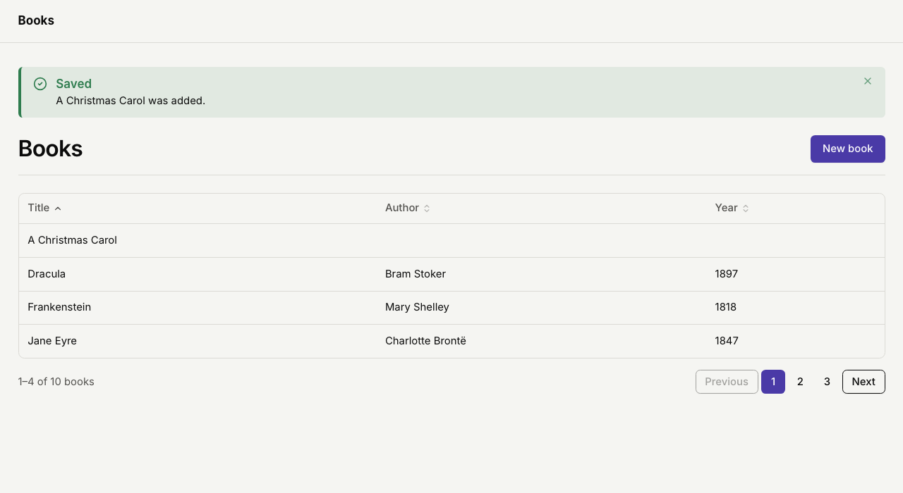

# Step 3: A form

A "New book" form with one field. Saving adds the book to the list, goes
back to the list, and shows "Saved" once.



## The code

Keep the same `books` directory and replace `main.go` from step 2 with this:

<!-- file: examples/03-form/main.go -->
```go
// Command books is tutorial step 3: a form that adds a book to the list.
package main

import (
	"log"
	"net/http"
	"strings"
	"sync"

	"github.com/bplus/webframe/assets"
	"github.com/bplus/webframe/components/action"
	"github.com/bplus/webframe/components/appshell"
	"github.com/bplus/webframe/components/datatable"
	"github.com/bplus/webframe/components/flash"
	"github.com/bplus/webframe/components/formfield"
	"github.com/bplus/webframe/components/formpage"
	"github.com/bplus/webframe/components/listpage"
	"github.com/bplus/webframe/components/pageheader"
	"github.com/bplus/webframe/listquery"
)

var app = &appshell.App{Name: "Books", Flash: flash.Take}

type Book struct {
	Title  string
	Author string
	Year   string
}

// books is the whole database: a slice in memory. The server runs requests
// at the same time, so every read or change of books holds booksLock.
var booksLock sync.Mutex
var books = []Book{
	{Title: "Pride and Prejudice", Author: "Jane Austen", Year: "1813"},
	{Title: "Frankenstein", Author: "Mary Shelley", Year: "1818"},
	{Title: "Jane Eyre", Author: "Charlotte Brontë", Year: "1847"},
	{Title: "Moby-Dick", Author: "Herman Melville", Year: "1851"},
	{Title: "Little Women", Author: "Louisa May Alcott", Year: "1868"},
	{Title: "Middlemarch", Author: "George Eliot", Year: "1871"},
	{Title: "Treasure Island", Author: "Robert Louis Stevenson", Year: "1883"},
	{Title: "The Time Machine", Author: "H. G. Wells", Year: "1895"},
	{Title: "Dracula", Author: "Bram Stoker", Year: "1897"},
}

// bookQuery is what the list reads from the URL: ?sort=year&dir=desc&page=2.
var bookQuery = listquery.Options{
	DefaultSort:     "title",
	DefaultPageSize: 4,
	AllowedSorts:    []string{"title", "author", "year"},
}

// sorters says how to order two books for each sortable column.
var sorters = map[string]func(a, b Book) bool{
	"title":  func(a, b Book) bool { return a.Title < b.Title },
	"author": func(a, b Book) bool { return a.Author < b.Author },
	"year":   func(a, b Book) bool { return a.Year < b.Year },
}

func listBooks(w http.ResponseWriter, r *http.Request) {
	spec := listquery.Parse(r, bookQuery)
	booksLock.Lock()
	page := listquery.Apply(books, spec, sorters, nil)
	booksLock.Unlock()

	var rows []datatable.Row
	for _, book := range page.Items {
		rows = append(rows, datatable.Row{Cells: []datatable.Cell{
			{Text: book.Title}, {Text: book.Author}, {Text: book.Year},
		}})
	}

	list := listpage.Props{
		Header: pageheader.Props{
			Title:   "Books",
			Primary: &action.Action{Label: "New book", Href: "/books/new", Variant: action.VariantPrimary},
		},
		Columns: []datatable.Column{
			{Key: "title", Label: "Title", Sortable: true},
			{Key: "author", Label: "Author", Sortable: true},
			{Key: "year", Label: "Year", Sortable: true},
		},
		Rows:  rows,
		Spec:  page.Spec,
		Total: page.Total,
		Noun:  "books",
	}
	if err := listpage.Respond(w, r, "Books", list); err != nil {
		log.Print(err)
	}
}

// bookForm declares the form page: a header, one field, Cancel and Save.
var bookForm = formpage.Props{
	Header: pageheader.Props{Title: "New book", Back: &pageheader.Link{Label: "Books", Href: "/books"}},
	Action: "/books",
	HxPost: true,
	Sections: []formpage.Section{{Fields: []formfield.Field{
		{Name: "title", Label: "Title"},
	}}},
	Cancel: &action.Action{Label: "Cancel", Href: "/books"},
}

func newBook(w http.ResponseWriter, r *http.Request) {
	if err := formpage.Respond(w, r, "New book", bookForm); err != nil {
		log.Print(err)
	}
}

func createBook(w http.ResponseWriter, r *http.Request) {
	book := Book{Title: strings.TrimSpace(r.FormValue("title"))}
	booksLock.Lock()
	books = append(books, book)
	booksLock.Unlock()
	flash.Success(w, r, "Saved", book.Title+" was added.")
	appshell.Redirect(w, r, "/books")
}

func routes() http.Handler {
	mux := http.NewServeMux()
	assets.Mount(mux)
	mux.Handle("GET /{$}", http.RedirectHandler("/books", http.StatusSeeOther))
	mux.HandleFunc("GET /books", listBooks)
	mux.HandleFunc("GET /books/new", newBook)
	mux.HandleFunc("POST /books", createBook)
	return app.Middleware(mux)
}

func main() {
	log.Print("listening on http://localhost:8080")
	log.Fatal(http.ListenAndServe(":8080", routes()))
}
```

## Run it

Run `go run .`, open http://localhost:8080, press **New book**, type a
title and press **Save**.

## What each piece does

**`Flash: flash.Take`** on `app` turns on one-time messages. A handler sets a
message, the next page shows it in a banner, and it is gone after that.

**`booksLock`** is a `sync.Mutex`. Go's web server handles requests at the
same time, and now one of them can change `books` while another reads it.
`Lock` and `Unlock` around every use make them take turns. In `listBooks`
the lock wraps the `listquery.Apply` call.

**`Primary`** in the list's header adds the **New book** button, a plain link
to `/books/new`. `action.VariantPrimary` makes it the filled button.

**`bookForm`** declares the form page once:

- `Header` has a title and a back link to the list.
- `Action: "/books"` is where the form posts.
- `HxPost: true` submits through htmx, so a page with an error (step 4)
  can replace just the form. The form still posts the normal way if
  JavaScript is off.
- `Sections` holds the fields. Here one section has one field, named
  `title`. The name is the key the handler reads.
- `Cancel` adds a Cancel link next to the Save button. Save is the default
  submit button, so it needs no line.

**`newBook`** shows the empty form with `formpage.Respond`.

**`createBook`** handles the POST:

1. `r.FormValue("title")` reads the field, and `strings.TrimSpace` drops
   spaces around it.
2. It appends the book to `books`, holding the lock.
3. `flash.Success(w, r, "Saved", ...)` stores the message in a short-lived
   cookie.
4. `appshell.Redirect` sends the browser back to the list, which reads the
   cookie, shows the banner and deletes the cookie.

**`appshell.Redirect`** answers a normal form post with a 303 redirect, so
pressing reload on the list does not post the form again, and an htmx submit
with an `HX-Redirect` header, which tells htmx to load the list as a full
page.

**`routes`** adds the two new routes: `GET /books/new` for the form and
`POST /books` for the save.

## Try it

- Add a book whose title starts with "A". The list is sorted by title, so
  it appears at the top of page 1. Other titles land in their alphabetical
  place, maybe on another page.
- Reload the list after saving. The banner is gone: it shows once.
- Press **Save** with the field empty. It saves anyway: the banner reads
  "Saved" over "was added." with no title in front, and a blank row appears
  at the top of the list (an empty title sorts first). Step 4 stops that.

Next: [Step 4: Bad input](04-validation.md)
