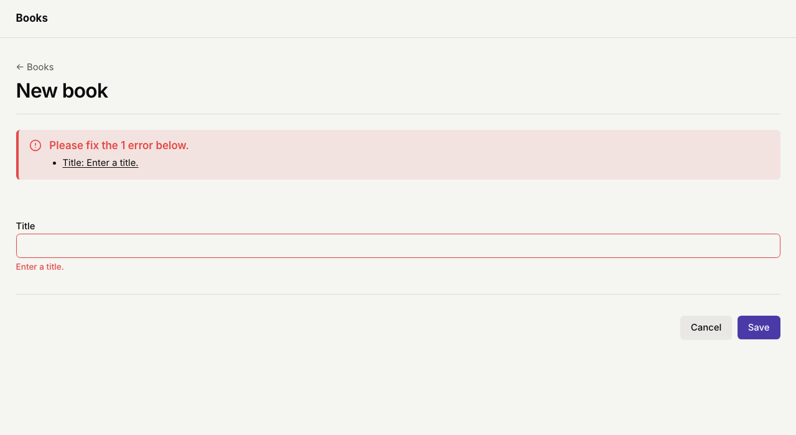

# Step 4: Bad input

The form now refuses a title that is empty or shorter than 3 characters. It
comes back with what you typed still in the field and the error under it,
and nothing is saved.



## The code

Replace `main.go` from step 3 with this. `createBook` changed, and
`checkTitle` is new:

<!-- file: examples/04-validation/main.go -->
```go
// Command books is tutorial step 4: the form refuses a missing or too short title.
package main

import (
	"log"
	"net/http"
	"strings"
	"sync"
	"unicode/utf8"

	"github.com/bplus/webframe/assets"
	"github.com/bplus/webframe/components/action"
	"github.com/bplus/webframe/components/appshell"
	"github.com/bplus/webframe/components/datatable"
	"github.com/bplus/webframe/components/flash"
	"github.com/bplus/webframe/components/formfield"
	"github.com/bplus/webframe/components/formpage"
	"github.com/bplus/webframe/components/listpage"
	"github.com/bplus/webframe/components/pageheader"
	"github.com/bplus/webframe/listquery"
)

var app = &appshell.App{Name: "Books", Flash: flash.Take}

type Book struct {
	Title  string
	Author string
	Year   string
}

// books is the whole database: a slice in memory. The server runs requests
// at the same time, so every read or change of books holds booksLock.
var booksLock sync.Mutex
var books = []Book{
	{Title: "Pride and Prejudice", Author: "Jane Austen", Year: "1813"},
	{Title: "Frankenstein", Author: "Mary Shelley", Year: "1818"},
	{Title: "Jane Eyre", Author: "Charlotte Brontë", Year: "1847"},
	{Title: "Moby-Dick", Author: "Herman Melville", Year: "1851"},
	{Title: "Little Women", Author: "Louisa May Alcott", Year: "1868"},
	{Title: "Middlemarch", Author: "George Eliot", Year: "1871"},
	{Title: "Treasure Island", Author: "Robert Louis Stevenson", Year: "1883"},
	{Title: "The Time Machine", Author: "H. G. Wells", Year: "1895"},
	{Title: "Dracula", Author: "Bram Stoker", Year: "1897"},
}

// bookQuery is what the list reads from the URL: ?sort=year&dir=desc&page=2.
var bookQuery = listquery.Options{
	DefaultSort:     "title",
	DefaultPageSize: 4,
	AllowedSorts:    []string{"title", "author", "year"},
}

// sorters says how to order two books for each sortable column.
var sorters = map[string]func(a, b Book) bool{
	"title":  func(a, b Book) bool { return a.Title < b.Title },
	"author": func(a, b Book) bool { return a.Author < b.Author },
	"year":   func(a, b Book) bool { return a.Year < b.Year },
}

func listBooks(w http.ResponseWriter, r *http.Request) {
	spec := listquery.Parse(r, bookQuery)
	booksLock.Lock()
	page := listquery.Apply(books, spec, sorters, nil)
	booksLock.Unlock()

	var rows []datatable.Row
	for _, book := range page.Items {
		rows = append(rows, datatable.Row{Cells: []datatable.Cell{
			{Text: book.Title}, {Text: book.Author}, {Text: book.Year},
		}})
	}

	list := listpage.Props{
		Header: pageheader.Props{
			Title:   "Books",
			Primary: &action.Action{Label: "New book", Href: "/books/new", Variant: action.VariantPrimary},
		},
		Columns: []datatable.Column{
			{Key: "title", Label: "Title", Sortable: true},
			{Key: "author", Label: "Author", Sortable: true},
			{Key: "year", Label: "Year", Sortable: true},
		},
		Rows:  rows,
		Spec:  page.Spec,
		Total: page.Total,
		Noun:  "books",
	}
	if err := listpage.Respond(w, r, "Books", list); err != nil {
		log.Print(err)
	}
}

// bookForm declares the form page: a header, one field, Cancel and Save.
var bookForm = formpage.Props{
	Header: pageheader.Props{Title: "New book", Back: &pageheader.Link{Label: "Books", Href: "/books"}},
	Action: "/books",
	HxPost: true,
	Sections: []formpage.Section{{Fields: []formfield.Field{
		{Name: "title", Label: "Title"},
	}}},
	Cancel: &action.Action{Label: "Cancel", Href: "/books"},
}

func newBook(w http.ResponseWriter, r *http.Request) {
	if err := formpage.Respond(w, r, "New book", bookForm); err != nil {
		log.Print(err)
	}
}

func createBook(w http.ResponseWriter, r *http.Request) {
	book := Book{Title: strings.TrimSpace(r.FormValue("title"))}
	if problem := checkTitle(book.Title); problem != "" {
		// Show the form again: what was typed back in the field, the
		// error under it. Respond answers 422 because Errors is set.
		form := bookForm
		form.Values = map[string]string{"title": r.FormValue("title")}
		form.Errors = map[string]string{"title": problem}
		if err := formpage.Respond(w, r, "New book", form); err != nil {
			log.Print(err)
		}
		return
	}
	booksLock.Lock()
	books = append(books, book)
	booksLock.Unlock()
	flash.Success(w, r, "Saved", book.Title+" was added.")
	appshell.Redirect(w, r, "/books")
}

// checkTitle says what is wrong with a title, or returns "" when it is fine.
// utf8.RuneCountInString counts characters; len would count bytes, and "é"
// is two of those.
func checkTitle(title string) string {
	if title == "" {
		return "Enter a title."
	}
	if utf8.RuneCountInString(title) < 3 {
		return "Enter at least 3 characters."
	}
	return ""
}

func routes() http.Handler {
	mux := http.NewServeMux()
	assets.Mount(mux)
	mux.Handle("GET /{$}", http.RedirectHandler("/books", http.StatusSeeOther))
	mux.HandleFunc("GET /books", listBooks)
	mux.HandleFunc("GET /books/new", newBook)
	mux.HandleFunc("POST /books", createBook)
	return app.Middleware(mux)
}

func main() {
	log.Print("listening on http://localhost:8080")
	log.Fatal(http.ListenAndServe(":8080", routes()))
}
```

## Run it

Run `go run .`, open http://localhost:8080/books/new, type `Hi` and press
**Save**. Then try it with the field empty.

## What each piece does

**`checkTitle`** holds the rules. It returns the message to show, or `""`
when the title is fine: "Enter a title." for an empty one, "Enter at least
3 characters." for a short one. `createBook` trims spaces before calling it,
so `"  Hi  "` counts as 2 characters.

**The `if problem := checkTitle(book.Title); problem != ""` block** in
`createBook` runs when a rule failed. It shows the form again instead of
saving:

- `form := bookForm` copies the form declaration, so the shared one stays
  clean for the next visitor.
- `form.Values` puts back what the user sent, keyed by field name.
- `form.Errors` sets `problem` as the message for the `title` field. The message shows
  under the field, the field gets a red border, and a banner at the top
  lists every error with a link to its field.
- `formpage.Respond` writes the form, and `return` stops before the save.

**Why 422.** When `Errors` is set, `formpage.Respond` answers with status 422
("Unprocessable Entity") instead of 200. The status tells the truth: the
request did not do what it asked. Tests, logs and monitoring can see the
failure without reading the page. htmx normally ignores the body of an error
response, but webframe's page shell configures it to swap HTML error
responses like successful ones, so the form with its errors still replaces
the old form. Your browser's developer console lists the 422 as a failed
request; that is expected.

**Why the typed value is kept.** The new page is built from `bookForm`, which
has empty fields. Without `Values`, typing `Hi` and pressing Save would bring
back an empty box with "Enter at least 3 characters." under it, and the user
would have to retype the title to fix it. With `Values`, `Hi` is still in the
box, so they add a word and save. With ten fields, losing them all over one
mistake would be much worse. `Values` holds the value exactly as sent,
spaces included.

**Why check on the server.** A check in the browser can be skipped: by
turning JavaScript off, by sending the request with another tool, or by
typing spaces. The server is the one place every request passes through.

## Try it

- Type only spaces and press **Save**. "Enter a title." appears and the
  spaces are still in the field.
- Type `Emma` and press **Save**. It is long enough, so it is saved.
- Delete the `form.Values = ...` line, run again and submit `Hi`. The box
  comes back empty. Put the line back.
- Add `Required: true` to the `title` field in `bookForm`. The label gets a
  marker and the browser now refuses an empty field before it sends
  anything. Spaces still get through, which is why the server check stays.

Next: [Step 5: A detail page](05-detail.md)
