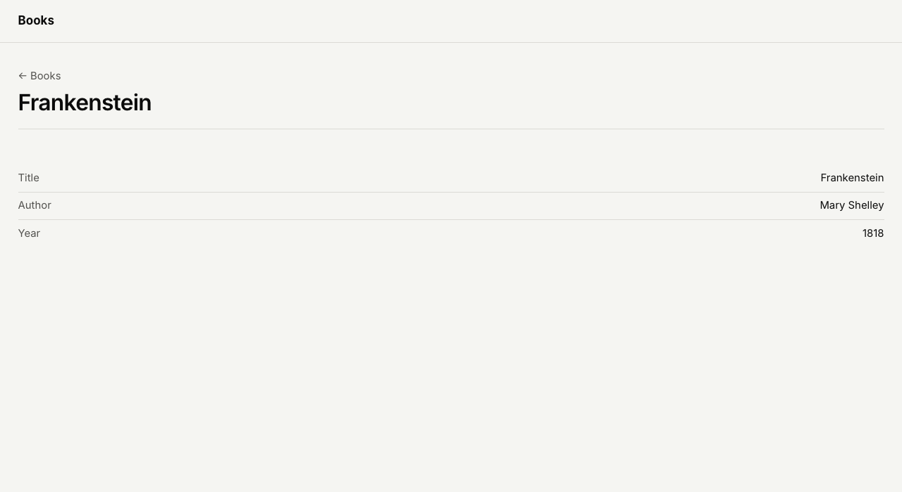

# Step 5: A detail page

Each book now has its own page at `/books/{id}`, showing its title, author
and year. The titles in the list link to it, and an id that does not exist
answers with a "Page not found" page.



## The code

Keep the same `books` directory and replace `main.go` from step 4 with this.
`Book` has an `ID`, the list's title cells link, `createBook` gives new
books an id, and `findBook` and `showBook` are new:

<!-- file: examples/05-detail/main.go -->
```go
// Command books is tutorial step 5: a page for one book, linked from the list.
package main

import (
	"log"
	"net/http"
	"strconv"
	"strings"
	"sync"
	"unicode/utf8"

	"github.com/bplus/webframe/assets"
	"github.com/bplus/webframe/components/action"
	"github.com/bplus/webframe/components/appshell"
	"github.com/bplus/webframe/components/datatable"
	"github.com/bplus/webframe/components/descriptionlist"
	"github.com/bplus/webframe/components/detailpage"
	"github.com/bplus/webframe/components/errorpage"
	"github.com/bplus/webframe/components/flash"
	"github.com/bplus/webframe/components/formfield"
	"github.com/bplus/webframe/components/formpage"
	"github.com/bplus/webframe/components/listpage"
	"github.com/bplus/webframe/components/pageheader"
	"github.com/bplus/webframe/liststate"
)

var app = &appshell.App{Name: "Books", Flash: flash.Take}

// ID names a book in its URL, /books/3. It never changes, while the
// book's place in the slice does whenever the list is sorted.
type Book struct {
	ID     string
	Title  string
	Author string
	Year   string
}

// books is the whole database: a slice in memory. The server runs requests
// at the same time, so every read or change of books holds booksLock.
var booksLock sync.Mutex
var books = []Book{
	{ID: "1", Title: "Pride and Prejudice", Author: "Jane Austen", Year: "1813"},
	{ID: "2", Title: "Frankenstein", Author: "Mary Shelley", Year: "1818"},
	{ID: "3", Title: "Jane Eyre", Author: "Charlotte Brontë", Year: "1847"},
	{ID: "4", Title: "Moby-Dick", Author: "Herman Melville", Year: "1851"},
	{ID: "5", Title: "Little Women", Author: "Louisa May Alcott", Year: "1868"},
	{ID: "6", Title: "Middlemarch", Author: "George Eliot", Year: "1871"},
	{ID: "7", Title: "Treasure Island", Author: "Robert Louis Stevenson", Year: "1883"},
	{ID: "8", Title: "The Time Machine", Author: "H. G. Wells", Year: "1895"},
	{ID: "9", Title: "Dracula", Author: "Bram Stoker", Year: "1897"},
}

// lastID is the highest id handed out so far. The books above use 1 to 9.
var lastID = 9

// bookQuery is what the list reads from the URL: ?sort=year&dir=desc&page=2.
var bookQuery = liststate.Options{
	DefaultSort:     "title",
	DefaultPageSize: 4,
	AllowedSorts:    []string{"title", "author", "year"},
}

// sorters says how to order two books for each sortable column.
var sorters = map[string]func(a, b Book) bool{
	"title":  func(a, b Book) bool { return a.Title < b.Title },
	"author": func(a, b Book) bool { return a.Author < b.Author },
	"year":   func(a, b Book) bool { return a.Year < b.Year },
}

func listBooks(w http.ResponseWriter, r *http.Request) {
	spec := liststate.Parse(r, bookQuery)
	booksLock.Lock()
	page := liststate.Apply(books, spec, sorters, nil)
	booksLock.Unlock()

	var rows []datatable.Row
	for _, book := range page.Items {
		rows = append(rows, datatable.Row{Cells: []datatable.Cell{
			{Text: book.Title, Href: "/books/" + book.ID}, {Text: book.Author}, {Text: book.Year},
		}})
	}

	list := listpage.Props{
		Header: pageheader.Props{
			Title:   "Books",
			Primary: &action.Action{Label: "New book", Href: "/books/new", Variant: action.VariantPrimary},
		},
		Columns: []datatable.Column{
			{Key: "title", Label: "Title", Sortable: true},
			{Key: "author", Label: "Author", Sortable: true},
			{Key: "year", Label: "Year", Sortable: true},
		},
		Rows:  rows,
		Spec:  page.Spec,
		Total: page.Total,
		Noun:  "books",
	}
	if err := listpage.Respond(w, r, "Books", list); err != nil {
		log.Print(err)
	}
}

// bookForm declares the form page: a header, one field, Cancel and Save.
var bookForm = formpage.Props{
	Header: pageheader.Props{Title: "New book", Back: &pageheader.Link{Label: "Books", Href: "/books"}},
	Action: "/books",
	HxPost: true,
	Sections: []formpage.Section{{Fields: []formfield.Field{
		{Name: "title", Label: "Title"},
	}}},
	Cancel: &action.Action{Label: "Cancel", Href: "/books"},
}

func newBook(w http.ResponseWriter, r *http.Request) {
	if err := formpage.Respond(w, r, "New book", bookForm); err != nil {
		log.Print(err)
	}
}

func createBook(w http.ResponseWriter, r *http.Request) {
	book := Book{Title: strings.TrimSpace(r.FormValue("title"))}
	if problem := checkTitle(book.Title); problem != "" {
		// Show the form again: what was typed back in the field, the
		// error under it. Respond answers 422 because Errors is set.
		form := bookForm
		form.Values = map[string]string{"title": r.FormValue("title")}
		form.Errors = map[string]string{"title": problem}
		if err := formpage.Respond(w, r, "New book", form); err != nil {
			log.Print(err)
		}
		return
	}
	booksLock.Lock()
	lastID++
	book.ID = strconv.Itoa(lastID)
	books = append(books, book)
	booksLock.Unlock()
	flash.Success(w, r, "Saved", book.Title+" was added.")
	appshell.Redirect(w, r, "/books")
}

// checkTitle says what is wrong with a title, or returns "" when it is fine.
// utf8.RuneCountInString counts characters; len would count bytes, and "é"
// is two of those.
func checkTitle(title string) string {
	if title == "" {
		return "Enter a title."
	}
	if utf8.RuneCountInString(title) < 3 {
		return "Enter at least 3 characters."
	}
	return ""
}

// findBook returns the book with this id, or false when there is none.
func findBook(id string) (Book, bool) {
	booksLock.Lock()
	defer booksLock.Unlock()
	for _, book := range books {
		if book.ID == id {
			return book, true
		}
	}
	return Book{}, false
}

func showBook(w http.ResponseWriter, r *http.Request) {
	book, found := findBook(r.PathValue("id"))
	if !found {
		// The styled 404 page, in the same shell as every other page.
		if err := errorpage.NotFound(w, r); err != nil {
			log.Print(err)
		}
		return
	}
	page := detailpage.Props{
		Header: pageheader.Props{Title: book.Title, Back: &pageheader.Link{Label: "Books", Href: "/books"}},
		Summary: []descriptionlist.Item{
			{Label: "Title", Value: book.Title},
			{Label: "Author", Value: book.Author},
			{Label: "Year", Value: book.Year},
		},
	}
	if err := detailpage.Respond(w, r, book.Title, page); err != nil {
		log.Print(err)
	}
}

func routes() http.Handler {
	mux := http.NewServeMux()
	assets.Mount(mux)
	mux.Handle("GET /{$}", http.RedirectHandler("/books", http.StatusSeeOther))
	mux.HandleFunc("GET /books", listBooks)
	mux.HandleFunc("GET /books/new", newBook)
	mux.HandleFunc("GET /books/{id}", showBook)
	mux.HandleFunc("POST /books", createBook)
	return app.Middleware(mux)
}

func main() {
	log.Print("listening on http://localhost:8080")
	log.Fatal(http.ListenAndServe(":8080", routes()))
}
```

## Run it

Run `go run .`, open http://localhost:8080/books and click a title.

## What each piece does

**`ID` in `Book`** is the book's name in a URL. Until now a book was only a
position in the slice, and that position changes when the list is sorted or
a book is added. A link must keep pointing at the same book, so each book
gets an id that never changes. The id is a string because it only ever
appears in URLs. The seed books use `"1"` to `"9"`.

**`lastID`** is the highest id handed out so far. `createBook` adds one to
it and uses the result, turned into a string by `strconv.Itoa`, as the new
book's id. That happens while it holds `booksLock`, so two books saved at
the same moment cannot get the same id.

**`Href: "/books/" + book.ID`** on the title cell makes the title a link to
the book's page. The other cells stay plain text.

**`"GET /books/{id}"`** in `routes` matches `/books/3`, `/books/42` and so
on. `{id}` is a wildcard, and `r.PathValue("id")` reads what it matched.
`/books/new` still goes to `newBook`: Go's router prefers the more specific
pattern.

**`findBook`** walks the slice and returns the book with that id. Its second
result, `found`, is false when no book matches. `defer booksLock.Unlock()`
releases the lock when the function returns, whichever `return` that is.

**`showBook`** declares a `detailpage.Props` and calls `detailpage.Respond`,
the same pattern as the list and the form:

- `Header` is the page title with a back link to the list.
- `Summary` is a list of label and value rows. Each row is a
  `descriptionlist.Item`.

**`errorpage.NotFound`** answers an unknown id. It writes status 404 and a
"Page not found" page in the same shell as every other page, with a "Go
home" button. A plain-text 404 would leave the user on a bare white page
with no way back.

## Try it

- Open http://localhost:8080/books/999. You get the "Page not found" page.
- Add a book with the form, then click its title in the list. Its page
  shows the title. Author and year are empty, because the form only asks
  for a title.
- Add `SummaryColumns: 2,` to `page` in `showBook`. On a wide window the
  rows sit in two columns.

Next: [Step 6: Edit and delete](06-edit-delete.md)
