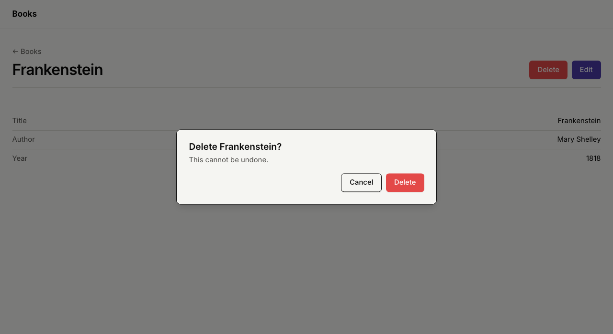

# Step 6: Edit and delete

The book's page now has **Edit** and **Delete** buttons. Edit opens the same
form as "New book", filled in with the book's title. Delete asks first, in a
dialog, then removes the book and goes back to the list.



## The code

Keep the same `books` directory and replace `main.go` from step 5 with this.
`showBook` has the two buttons and uses a new `notFound` helper, and
`editForm`, `editBook`, `updateBook` and `deleteBook` are new:

<!-- file: examples/06-edit-delete/main.go -->
```go
// Command books is tutorial step 6: the same form edits a book, and delete asks first.
package main

import (
	"log"
	"net/http"
	"strconv"
	"strings"
	"sync"
	"unicode/utf8"

	"github.com/bplus/webframe/assets"
	"github.com/bplus/webframe/components/action"
	"github.com/bplus/webframe/components/appshell"
	"github.com/bplus/webframe/components/datatable"
	"github.com/bplus/webframe/components/descriptionlist"
	"github.com/bplus/webframe/components/detailpage"
	"github.com/bplus/webframe/components/errorpage"
	"github.com/bplus/webframe/components/flash"
	"github.com/bplus/webframe/components/formfield"
	"github.com/bplus/webframe/components/formpage"
	"github.com/bplus/webframe/components/listpage"
	"github.com/bplus/webframe/components/pageheader"
	"github.com/bplus/webframe/listquery"
)

var app = &appshell.App{Name: "Books", Flash: flash.Take}

// ID names a book in its URL, /books/3. It never changes, while the
// book's place in the slice does whenever the list is sorted.
type Book struct {
	ID     string
	Title  string
	Author string
	Year   string
}

// books is the whole database: a slice in memory. The server runs requests
// at the same time, so every read or change of books holds booksLock.
var booksLock sync.Mutex
var books = []Book{
	{ID: "1", Title: "Pride and Prejudice", Author: "Jane Austen", Year: "1813"},
	{ID: "2", Title: "Frankenstein", Author: "Mary Shelley", Year: "1818"},
	{ID: "3", Title: "Jane Eyre", Author: "Charlotte Brontë", Year: "1847"},
	{ID: "4", Title: "Moby-Dick", Author: "Herman Melville", Year: "1851"},
	{ID: "5", Title: "Little Women", Author: "Louisa May Alcott", Year: "1868"},
	{ID: "6", Title: "Middlemarch", Author: "George Eliot", Year: "1871"},
	{ID: "7", Title: "Treasure Island", Author: "Robert Louis Stevenson", Year: "1883"},
	{ID: "8", Title: "The Time Machine", Author: "H. G. Wells", Year: "1895"},
	{ID: "9", Title: "Dracula", Author: "Bram Stoker", Year: "1897"},
}

// lastID is the highest id handed out so far. The books above use 1 to 9.
var lastID = 9

// bookQuery is what the list reads from the URL: ?sort=year&dir=desc&page=2.
var bookQuery = listquery.Options{
	DefaultSort:     "title",
	DefaultPageSize: 4,
	AllowedSorts:    []string{"title", "author", "year"},
}

// sorters says how to order two books for each sortable column.
var sorters = map[string]func(a, b Book) bool{
	"title":  func(a, b Book) bool { return a.Title < b.Title },
	"author": func(a, b Book) bool { return a.Author < b.Author },
	"year":   func(a, b Book) bool { return a.Year < b.Year },
}

func listBooks(w http.ResponseWriter, r *http.Request) {
	spec := listquery.Parse(r, bookQuery)
	booksLock.Lock()
	page := listquery.Apply(books, spec, sorters, nil)
	booksLock.Unlock()

	var rows []datatable.Row
	for _, book := range page.Items {
		rows = append(rows, datatable.Row{Cells: []datatable.Cell{
			{Text: book.Title, Href: "/books/" + book.ID}, {Text: book.Author}, {Text: book.Year},
		}})
	}

	list := listpage.Props{
		Header: pageheader.Props{
			Title:   "Books",
			Primary: &action.Action{Label: "New book", Href: "/books/new", Variant: action.VariantPrimary},
		},
		Columns: []datatable.Column{
			{Key: "title", Label: "Title", Sortable: true},
			{Key: "author", Label: "Author", Sortable: true},
			{Key: "year", Label: "Year", Sortable: true},
		},
		Rows:  rows,
		Spec:  page.Spec,
		Total: page.Total,
		Noun:  "books",
	}
	if err := listpage.Respond(w, r, "Books", list); err != nil {
		log.Print(err)
	}
}

// bookForm declares the form page: a header, one field, Cancel and Save.
// Creating and editing both use it; editForm changes what differs.
var bookForm = formpage.Props{
	Header: pageheader.Props{Title: "New book", Back: &pageheader.Link{Label: "Books", Href: "/books"}},
	Action: "/books",
	HxPost: true,
	Sections: []formpage.Section{{Fields: []formfield.Field{
		{Name: "title", Label: "Title"},
	}}},
	Cancel: &action.Action{Label: "Cancel", Href: "/books"},
}

func newBook(w http.ResponseWriter, r *http.Request) {
	if err := formpage.Respond(w, r, "New book", bookForm); err != nil {
		log.Print(err)
	}
}

func createBook(w http.ResponseWriter, r *http.Request) {
	book := Book{Title: strings.TrimSpace(r.FormValue("title"))}
	if problem := checkTitle(book.Title); problem != "" {
		// Show the form again: what was typed back in the field, the
		// error under it. Respond answers 422 because Errors is set.
		form := bookForm
		form.Values = map[string]string{"title": r.FormValue("title")}
		form.Errors = map[string]string{"title": problem}
		if err := formpage.Respond(w, r, "New book", form); err != nil {
			log.Print(err)
		}
		return
	}
	booksLock.Lock()
	lastID++
	book.ID = strconv.Itoa(lastID)
	books = append(books, book)
	booksLock.Unlock()
	flash.Success(w, r, "Saved", book.Title+" was added.")
	appshell.Redirect(w, r, "/books")
}

// editForm is bookForm for an existing book: its own header, Cancel back
// to the book, the form posting to /books/{id}, and the book's current
// title in the field.
func editForm(book Book) formpage.Props {
	form := bookForm
	form.Header = pageheader.Props{Title: "Edit book", Back: &pageheader.Link{Label: book.Title, Href: "/books/" + book.ID}}
	form.Action = "/books/" + book.ID
	form.Cancel = &action.Action{Label: "Cancel", Href: "/books/" + book.ID}
	form.Values = map[string]string{"title": book.Title}
	return form
}

func editBook(w http.ResponseWriter, r *http.Request) {
	book, found := findBook(r.PathValue("id"))
	if !found {
		notFound(w, r)
		return
	}
	if err := formpage.Respond(w, r, "Edit book", editForm(book)); err != nil {
		log.Print(err)
	}
}

func updateBook(w http.ResponseWriter, r *http.Request) {
	book, found := findBook(r.PathValue("id"))
	if !found {
		notFound(w, r)
		return
	}
	title := strings.TrimSpace(r.FormValue("title"))
	if problem := checkTitle(title); problem != "" {
		form := editForm(book)
		form.Values = map[string]string{"title": r.FormValue("title")}
		form.Errors = map[string]string{"title": problem}
		if err := formpage.Respond(w, r, "Edit book", form); err != nil {
			log.Print(err)
		}
		return
	}
	book.Title = title
	booksLock.Lock()
	for i := range books {
		if books[i].ID == book.ID {
			books[i] = book
		}
	}
	booksLock.Unlock()
	flash.Success(w, r, "Saved", book.Title+" was updated.")
	appshell.Redirect(w, r, "/books/"+book.ID)
}

func deleteBook(w http.ResponseWriter, r *http.Request) {
	book, found := findBook(r.PathValue("id"))
	if !found {
		// Deleted already, in another tab say. The user wanted it gone,
		// and it is, so this is not an error page.
		flash.Info(w, r, "Already deleted", "That book was not in the list any more.")
		appshell.Redirect(w, r, "/books")
		return
	}
	booksLock.Lock()
	for i := range books {
		if books[i].ID == book.ID {
			books = append(books[:i], books[i+1:]...)
			break
		}
	}
	booksLock.Unlock()
	flash.Success(w, r, "Deleted", book.Title+" was deleted.")
	appshell.Redirect(w, r, "/books")
}

// checkTitle says what is wrong with a title, or returns "" when it is fine.
// utf8.RuneCountInString counts characters; len would count bytes, and "é"
// is two of those.
func checkTitle(title string) string {
	if title == "" {
		return "Enter a title."
	}
	if utf8.RuneCountInString(title) < 3 {
		return "Enter at least 3 characters."
	}
	return ""
}

// findBook returns the book with this id, or false when there is none.
func findBook(id string) (Book, bool) {
	booksLock.Lock()
	defer booksLock.Unlock()
	for _, book := range books {
		if book.ID == id {
			return book, true
		}
	}
	return Book{}, false
}

func showBook(w http.ResponseWriter, r *http.Request) {
	book, found := findBook(r.PathValue("id"))
	if !found {
		notFound(w, r)
		return
	}
	page := detailpage.Props{
		Header: pageheader.Props{
			Title:   book.Title,
			Back:    &pageheader.Link{Label: "Books", Href: "/books"},
			Primary: &action.Action{Label: "Edit", Href: "/books/" + book.ID + "/edit", Variant: action.VariantPrimary},
			Secondary: []action.Action{{
				Label:    "Delete",
				Variant:  action.VariantDestructive,
				HxDelete: "/books/" + book.ID,
				Confirm:  &action.Confirm{Title: "Delete " + book.Title + "?", Message: "This cannot be undone.", ConfirmLabel: "Delete"},
			}},
		},
		Summary: []descriptionlist.Item{
			{Label: "Title", Value: book.Title},
			{Label: "Author", Value: book.Author},
			{Label: "Year", Value: book.Year},
		},
	}
	if err := detailpage.Respond(w, r, book.Title, page); err != nil {
		log.Print(err)
	}
}

// notFound answers with the styled 404 page, in the same shell as every
// other page.
func notFound(w http.ResponseWriter, r *http.Request) {
	if err := errorpage.NotFound(w, r); err != nil {
		log.Print(err)
	}
}

func routes() http.Handler {
	mux := http.NewServeMux()
	assets.Mount(mux)
	mux.Handle("GET /{$}", http.RedirectHandler("/books", http.StatusSeeOther))
	mux.HandleFunc("GET /books", listBooks)
	mux.HandleFunc("GET /books/new", newBook)
	mux.HandleFunc("GET /books/{id}", showBook)
	mux.HandleFunc("GET /books/{id}/edit", editBook)
	mux.HandleFunc("POST /books/{id}", updateBook)
	mux.HandleFunc("DELETE /books/{id}", deleteBook)
	mux.HandleFunc("POST /books", createBook)
	return app.Middleware(mux)
}

func main() {
	log.Print("listening on http://localhost:8080")
	log.Fatal(http.ListenAndServe(":8080", routes()))
}
```

## Run it

Run `go run .`, open http://localhost:8080/books and click a title. Press
**Edit**, change the title and press **Save**. Then press **Delete**.

## What each piece does

**The header in `showBook`** now has buttons. `Primary` is Edit, a plain
link to `/books/{id}/edit`. `Secondary` holds Delete. Each is an
`action.Action`, the same type as the list's "New book" button.

**`editForm`** builds the edit form from `bookForm`. Creating and editing
are one form declaration: the field, its rules and the Save button are
written once. `editForm` copies `bookForm` and changes only what differs for
an existing book:

- `Header` says "Edit book" and links back to the book.
- `Action` is `/books/{id}`, so Save posts to this book.
- `Cancel` goes back to the book instead of the list.
- `Values` puts the book's current title in the field.

If you add a field to `bookForm` later, both forms get it.

**`editBook`** shows that form. An unknown id gets the 404 page.

**`updateBook`** handles Save. It is `createBook` with two changes. A
refused title shows `editForm(book)` again, with what was typed and the
error, so the 422 behaves exactly as in step 4. A good title replaces the
book in the slice instead of adding one. Then it sets the "Saved" flash and
calls `appshell.Redirect` to go back to the book's page. The form only has
a title, so the author and year stay as they were.

**`deleteBook`** removes the book from the slice, sets a "Deleted" flash and
calls `appshell.Redirect` to go to the list. Delete is sent by htmx, so
`appshell.Redirect` answers with an `HX-Redirect` header, and htmx then
loads the list as a full page, where the flash shows once. A book that is
already gone (deleted in another tab, say) gets an "Already deleted" notice
instead. It is not an error page because the user wanted the book gone, and
it is.

**The Delete action** has three fields that matter:

- `HxDelete: "/books/" + book.ID` makes it a button that sends an HTTP
  `DELETE` request to that URL. The route is `"DELETE /books/{id}"`.
- `Variant: action.VariantDestructive` colors it red, because it destroys
  something.
- `Confirm` asks before sending. `Title` and `Message` are the dialog's
  text, `ConfirmLabel` is its button. Cancel, Escape or a click outside the
  dialog sends nothing.

**Why the styled dialog.** `Confirm` becomes htmx's `hx-confirm` attribute.
On its own, htmx would show the browser's built-in confirm box: plain text,
buttons labelled OK and Cancel, styled by the browser, and on some browsers
with a checkbox to stop the site showing dialogs. Every webframe page also
loads a small script and a hidden dialog, and the script shows that dialog
instead. It uses your title, says "Delete" rather than "OK" on a red button
(because of `VariantDestructive`), puts the focus on Cancel so a stray Enter
does not delete, and looks like the rest of the app. You only set
`Confirm`; there is nothing to wire up. If the script fails to load, the
browser's box appears instead, so the question is still asked.

**Without JavaScript**, htmx does not run, so the Delete button does
nothing: no dialog, no request, nothing is deleted. A plain HTML link or
form cannot send a `DELETE` request, and the button is not inside a form.
Edit keeps working, because it is a plain link to a page with a plain form.
The handler itself does not need JavaScript: a `DELETE` request from
another tool, such as `curl -X DELETE`, gets a 303 redirect to the list.

## Try it

- Edit a book and save a 2-character title. The error shows and the old
  title stays in the list.
- Press **Delete**, then **Cancel**. Nothing changes. Press it again and
  confirm: the list shows "Deleted".
- Delete a book, press the browser's Back button to its page and reload.
  It is the "Page not found" page now.
- Run `curl -i -X DELETE http://localhost:8080/books/2`. The answer is
  `303 See Other` with `Location: /books`, and Frankenstein is gone from
  the list.

Next: [Step 7: The templ version](07-templ.md)
