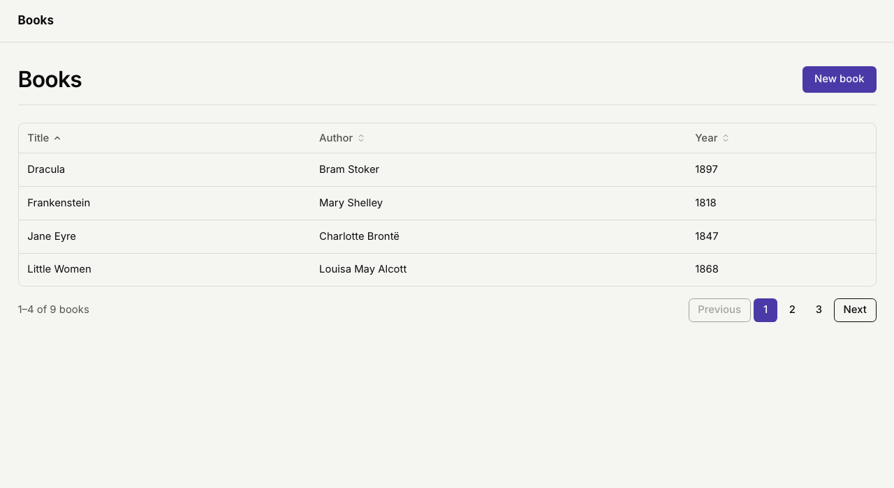
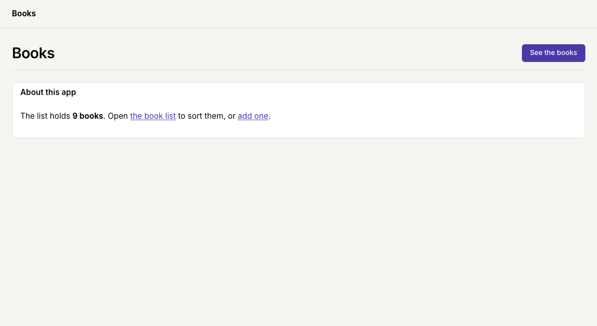

# Step 7: The templ version

This is step 4's program again, with one difference: the part that puts
components together is written in a `.templ` file instead of in Go. The
list and the form work exactly as before. The list page looks identical to
step 4's:



Step 4 sent `/` straight to `/books`. To give the templ file something to
build, `/` is now a small home page: a header, then a panel holding a
sentence with bold text and two links.



## Plain Go or templ

[templ](https://templ.guide) is a language for writing HTML components. You
write a `.templ` file, the `templ generate` command turns it into a
`_templ.go` file, and Go compiles that like any other code. webframe itself
is written this way.

Steps 1 to 6 used no `.templ` files, and you never need one. Both styles
build the same components and render the same HTML. Pick the one you find
easier to read. A common split, used here:

- **Page declarations stay in Go.** `listpage.Props` and `formpage.Props`
  are data: lists of columns, rows and fields. Data reads best as Go.
- **Component trees go in templ.** A page body made of several components,
  with content nested inside some of them, reads more like the page itself
  when it is written in templ.

## Prerequisites

Install the `templ` command. Use the same version as the templ library your
module depends on (webframe needs `v0.3.1001`; `go list -m github.com/a-h/templ`
shows yours):

```sh
go install github.com/a-h/templ/cmd/templ@v0.3.1001
```

## The code

This step adds a file to the same `books` project. Save this as
`home.templ`, next to `main.go`:

<!-- file: examples/07-templ/home.templ -->
```templ
package main

import (
	"strconv"

	"github.com/bplus/webframe/components/action"
	"github.com/bplus/webframe/components/pageheader"
	"github.com/bplus/webframe/components/panel"
)

// homePage is the body of the home page: a header, then a panel holding a
// short paragraph. count is the number of books in the list.
templ homePage(count int) {
	@pageheader.PageHeader(pageheader.Props{
		Title:   "Books",
		Primary: &action.Action{Label: "See the books", Href: "/books", Variant: action.VariantPrimary},
	})
	@panel.Panel(panel.Props{Title: "About this app"}) {
		<p>
			The list holds <strong>{ strconv.Itoa(count) } books</strong>.
			Open <a href="/books">the book list</a> to sort them, or <a href="/books/new">add one</a>.
		</p>
	}
}
```

Then replace `main.go` with this. It starts from step 4's `main.go`, not
step 6's, so it has no book pages, Edit or Delete. Compared with step 4, the
package comment changed, the `home` handler is new, and the `GET /{$}` route
calls it:

<!-- file: examples/07-templ/main.go -->
```go
// Command books is tutorial step 7: step 4's program with the home page
// written in a .templ file (home.templ).
package main

import (
	"log"
	"net/http"
	"strings"
	"sync"
	"unicode/utf8"

	"github.com/bplus/webframe/assets"
	"github.com/bplus/webframe/components/action"
	"github.com/bplus/webframe/components/appshell"
	"github.com/bplus/webframe/components/datatable"
	"github.com/bplus/webframe/components/flash"
	"github.com/bplus/webframe/components/formfield"
	"github.com/bplus/webframe/components/formpage"
	"github.com/bplus/webframe/components/listpage"
	"github.com/bplus/webframe/components/pageheader"
	"github.com/bplus/webframe/liststate"
)

var app = &appshell.App{Name: "Books", Flash: flash.Take}

type Book struct {
	Title  string
	Author string
	Year   string
}

// books is the whole database: a slice in memory. The server runs requests
// at the same time, so every read or change of books holds booksLock.
var booksLock sync.Mutex
var books = []Book{
	{Title: "Pride and Prejudice", Author: "Jane Austen", Year: "1813"},
	{Title: "Frankenstein", Author: "Mary Shelley", Year: "1818"},
	{Title: "Jane Eyre", Author: "Charlotte Brontë", Year: "1847"},
	{Title: "Moby-Dick", Author: "Herman Melville", Year: "1851"},
	{Title: "Little Women", Author: "Louisa May Alcott", Year: "1868"},
	{Title: "Middlemarch", Author: "George Eliot", Year: "1871"},
	{Title: "Treasure Island", Author: "Robert Louis Stevenson", Year: "1883"},
	{Title: "The Time Machine", Author: "H. G. Wells", Year: "1895"},
	{Title: "Dracula", Author: "Bram Stoker", Year: "1897"},
}

// bookQuery is what the list reads from the URL: ?sort=year&dir=desc&page=2.
var bookQuery = liststate.Options{
	DefaultSort:     "title",
	DefaultPageSize: 4,
	AllowedSorts:    []string{"title", "author", "year"},
}

// sorters says how to order two books for each sortable column.
var sorters = map[string]func(a, b Book) bool{
	"title":  func(a, b Book) bool { return a.Title < b.Title },
	"author": func(a, b Book) bool { return a.Author < b.Author },
	"year":   func(a, b Book) bool { return a.Year < b.Year },
}

func listBooks(w http.ResponseWriter, r *http.Request) {
	spec := liststate.Parse(r, bookQuery)
	booksLock.Lock()
	page := liststate.Apply(books, spec, sorters, nil)
	booksLock.Unlock()

	var rows []datatable.Row
	for _, book := range page.Items {
		rows = append(rows, datatable.Row{Cells: []datatable.Cell{
			{Text: book.Title}, {Text: book.Author}, {Text: book.Year},
		}})
	}

	list := listpage.Props{
		Header: pageheader.Props{
			Title:   "Books",
			Primary: &action.Action{Label: "New book", Href: "/books/new", Variant: action.VariantPrimary},
		},
		Columns: []datatable.Column{
			{Key: "title", Label: "Title", Sortable: true},
			{Key: "author", Label: "Author", Sortable: true},
			{Key: "year", Label: "Year", Sortable: true},
		},
		Rows:  rows,
		Spec:  page.Spec,
		Total: page.Total,
		Noun:  "books",
	}
	if err := listpage.Respond(w, r, "Books", list); err != nil {
		log.Print(err)
	}
}

// bookForm declares the form page: a header, one field, Cancel and Save.
var bookForm = formpage.Props{
	Header: pageheader.Props{Title: "New book", Back: &pageheader.Link{Label: "Books", Href: "/books"}},
	Action: "/books",
	HxPost: true,
	Sections: []formpage.Section{{Fields: []formfield.Field{
		{Name: "title", Label: "Title"},
	}}},
	Cancel: &action.Action{Label: "Cancel", Href: "/books"},
}

func newBook(w http.ResponseWriter, r *http.Request) {
	if err := formpage.Respond(w, r, "New book", bookForm); err != nil {
		log.Print(err)
	}
}

func createBook(w http.ResponseWriter, r *http.Request) {
	book := Book{Title: strings.TrimSpace(r.FormValue("title"))}
	if problem := checkTitle(book.Title); problem != "" {
		// Show the form again: what was typed back in the field, the
		// error under it. Respond answers 422 because Errors is set.
		form := bookForm
		form.Values = map[string]string{"title": r.FormValue("title")}
		form.Errors = map[string]string{"title": problem}
		if err := formpage.Respond(w, r, "New book", form); err != nil {
			log.Print(err)
		}
		return
	}
	booksLock.Lock()
	books = append(books, book)
	booksLock.Unlock()
	flash.Success(w, r, "Saved", book.Title+" was added.")
	appshell.Redirect(w, r, "/books")
}

// checkTitle says what is wrong with a title, or returns "" when it is fine.
// utf8.RuneCountInString counts characters; len would count bytes, and "é"
// is two of those.
func checkTitle(title string) string {
	if title == "" {
		return "Enter a title."
	}
	if utf8.RuneCountInString(title) < 3 {
		return "Enter at least 3 characters."
	}
	return ""
}

// home shows the home page. Its body, homePage, is written in home.templ;
// templ generate turns it into the Go function in home_templ.go.
func home(w http.ResponseWriter, r *http.Request) {
	booksLock.Lock()
	count := len(books)
	booksLock.Unlock()
	if err := app.Render(w, r, "Home", homePage(count)); err != nil {
		log.Print(err)
	}
}

func routes() http.Handler {
	mux := http.NewServeMux()
	assets.Mount(mux)
	mux.HandleFunc("GET /{$}", home)
	mux.HandleFunc("GET /books", listBooks)
	mux.HandleFunc("GET /books/new", newBook)
	mux.HandleFunc("POST /books", createBook)
	return app.Middleware(mux)
}

func main() {
	log.Print("listening on http://localhost:8080")
	log.Fatal(http.ListenAndServe(":8080", routes()))
}
```

## Run it

```sh
templ generate
go mod tidy
go run .
```

`templ generate` writes `home_templ.go` next to `home.templ`. It holds the Go
function `homePage`, which `main.go` calls. Run `templ generate` again after
every change to a `.templ` file; Go never reads the `.templ` file itself.
`go mod tidy` records that your code now uses the templ library directly.

Open http://localhost:8080 for the home page, and
http://localhost:8080/books for the list.

## What each piece does

**`templ homePage(count int)`** declares a component. It works like a Go
function: it takes a parameter and, after `templ generate`, it is a Go
function `homePage(count int) templ.Component`. That is the same type every
webframe component returns, so `app.Render` takes it like any other page
body.

**`@pageheader.PageHeader(...)`** renders a component. The `@` marks a
component call. What follows is the same Go call you would write in
`main.go`, with the same `Props`.

**The block after `@panel.Panel(...)`** is the panel's content. A container
component shows whatever is inside that block. Components listed one after
another in a templ body render in that order, so no `compose.Join` is needed.

**`<p>`, `<strong>` and `<a>`** are written directly. The `wflint` linter
allows text-level elements like these in a `.templ` file. Block elements
such as `<div>`, and any `class` or `style` attribute, are still refused:
layout and design belong to components. `{ strconv.Itoa(count) }` inserts a
Go value as text, escaped.

**`home`** in `main.go` is an ordinary handler. It reads the book count
under the lock and passes it to `homePage`.

### The same body in plain Go

For comparison, here is `homePage` written in Go, the way steps 1 to 6 would
write it:

```go
func homePage(count int) templ.Component {
	return compose.Join(
		pageheader.PageHeader(pageheader.Props{
			Title:   "Books",
			Primary: &action.Action{Label: "See the books", Href: "/books", Variant: action.VariantPrimary},
		}),
		compose.With(panel.Panel(panel.Props{Title: "About this app"}),
			prose.Prose(prose.Props{Text: "The list holds " + strconv.Itoa(count) + " books."}),
		),
	)
}
```

What changes between the two:

- **A `.templ` file and a build step.** You run `templ generate` before
  `go run` or `go build`, and keep the templ command installed.
- **Content inside a container.** In templ it is the block after the call.
  In Go it is passed with `compose.With(parent, children...)`.
- **Components in a row.** In templ you list them. In Go you wrap them in
  `compose.Join`.
- **Inline text markup.** Only templ can write `<strong>` or `<a>` inside a
  sentence. The Go version has plain text in a `prose` component, or would
  need a component for each link.

What stays the same:

- Every component and its `Props`.
- `listpage.Respond`, `formpage.Respond`, `app.Render` and the rest of the
  handlers.
- The HTML that reaches the browser for the same components.
- `wflint` checks both styles.

### The generated file

`home_templ.go` is generated, so never edit it by hand. This repository
commits generated files, so a reader can see the Go that `templ generate`
produced and build without the templ command. Your project may choose not to
commit them; then every build, including CI, runs `templ generate` first.

## Try it

- Change the sentence in `home.templ`, then restart with `go run .` without
  running `templ generate`. The page does not change, because Go still
  compiles the old `home_templ.go`. Run `templ generate`, restart, and reload.
- Wrap the paragraph in a `<div>` and run the linter. Add it to your module
  once with `go get -tool github.com/bplus/webframe/cmd/wflint` (Go 1.24 or
  later), then run `go tool wflint .`. The linter refuses the `<div>` and
  suggests `layout.Stack` or `layout.Inline`. (`go run` with the package
  path does not work in an app module: the linter's own dependencies are
  not in your `go.sum`.)

That's the tutorial. To see every component, clone webframe, run `make dev`
and open the components showcase at http://localhost:3333. For the full API,
see the package reference on
[pkg.go.dev](https://pkg.go.dev/github.com/bplus/webframe).
